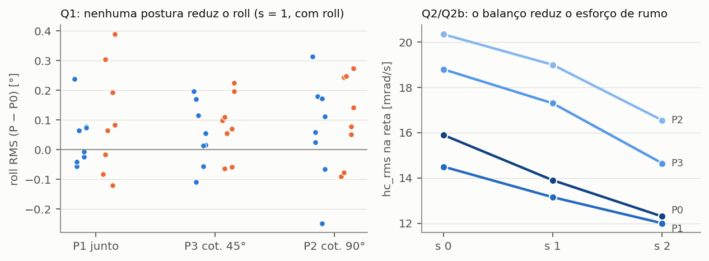
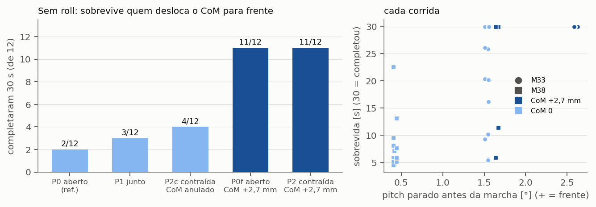
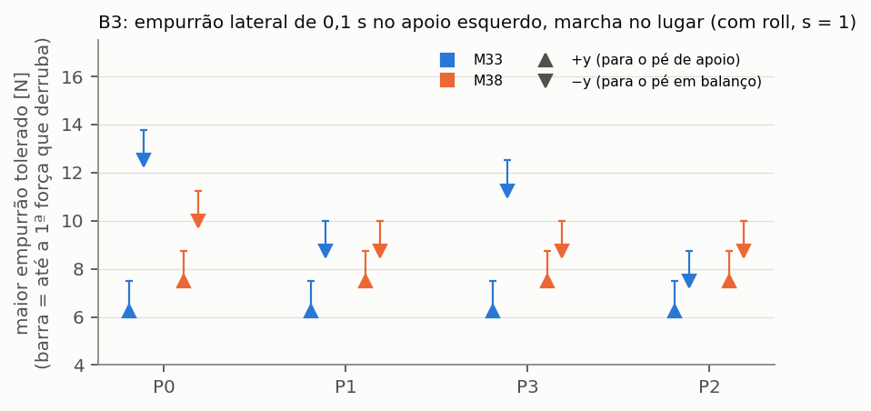

# Braços: qual postura é melhor para o equilíbrio e se o balanço ajuda

> Estado: **pré-registro escrito antes dos dados** (2026-11-13). Os resultados
> entram nas seções *Resultado*. Plano:
> `~/.claude/plans/eu-quero-efetuar-uma-lexical-canyon.md`, Parte B.
>
> **Escopo decidido pelo usuário:** só **malha aberta** (o balanço que já
> existe, com postura e fator configuráveis). **Nenhuma realimentação é
> implementada.** Ao fim, um parecer diz se os dados indicam que ela seria
> necessária (§8).

**Respostas (2026-11-14, B0–B3 concluídas; os detalhes estão nas seções *Resultado*):**

| pergunta (§3) | resposta | onde |
|---|---|---|
| 1. Qual postura? | **A atual, P0** (ombro aberto 50°, esticado), é a melhor ou empata. As contraídas não reduzem o roll e inclinam o tronco para frente (pitch RMS +29% a +46%). | B1 Q1 |
| 2. O balanço ajuda? | **No equilíbrio, não.** Na reta reduz o esforço da malha de rumo: −13% com s = 1 e −23% com s = 2 contra s = 0, em P0. No giro e no lateral o balanço quase não se mexe. | B1 Q2/Q2b |
| 3. Substitui o roll? | **O balanço, não.** A P2 contraída anda sem roll (11/12 contra 2/12), mas isso vem do CoM 2,7 mm à frente, não da postura: a P0 aberta com o ombro +18,7° faz o mesmo (11/12). | B2, B2x |
| 4. Empurrão lateral | **A P0 tolera mais ou empata** em todos os pares. Para o lado do pé de apoio, o limiar não depende da postura. | B3 |
| Realimentação? | O critério formal dá positivo, mas por diluição da Q2. **Não recomendo implementar agora.** A pergunta continua aberta com atrito baixo e no robô real. | §8 |

**Decisão do usuário (2026-11-14), depois dos resultados:** o default do launch passa a ser a **P2a**: a P2c com o ombro aberto 15° (`arm_shoulder_roll_deg` 15, `arm_elbow_deg` 90, `arm_shoulder_pitch_deg` −15,8).
- **Motivo:** no robô real, o braço da P2c raspa na estrutura.
- **Geometria (URDF), com o pior caso entre parado e balanço s = 2:**
  - o cotovelo fica a 25 mm do tronco, contra 4,5 mm na P2c;
  - perto do ombro a folga fica em ~6,5 mm em qualquer abertura;
  - −15,8° mantém o CoM x da P0.
- **Validação:** só corridas avulsas, sem GUI (M38 com roll):
  - reta 15 s;
  - lateral a 0,09 com `step_period` 0,5 / `y_separation` 0,05 e ff vx, por 20 s.
  - **Não passou por campanha.** Sem roll, deve se comportar como a P2c (4/12), mas isso é inferência.
- **Reprodutibilidade:** os `rodar_*.sh` passam a postura histórica (50°/0/0) antes dos args do desenho, então as campanhas anteriores se reproduzem como foram rodadas.

## 1. O que existia antes deste estudo (fatos do código)

**O balanço de braços do Maximo** (mestrado, §3.7, p. 71–72; Tabela 3.1, p. 72) roda desde sempre no gerador (`OmnidirectionalWalkZMP.cpp`).
- Cada braço segue o x do **pé oposto**: `θ_ombro_pitch = −asin(s · x_pé_oposto / armLength)`.
- s = `armsCompensationFactor` = 1,0, fixo no código.
- **O objetivo declarado é cancelar o momento de yaw induzido pelas pernas** (p. 71). No mestrado, o efeito só foi mostrado com atrito do chão reduzido a 0,4 (p. 97–99).
- **Amplitude medida:** ±8,2° de pitch do ombro a vx = 0,1. Saiu do teste offline `test_arm_posture`; nas corridas da E7, ±0,14 rad.
- O `armLength` = 0,3148 m não corresponde ao URDF (ombro → CoM da mão ≈ 0,21 m); na prática, s absorve isso.

**Postura histórica:**
- ombro aberto ±50°, fixo no código;
- **cotovelo nunca comandado na simulação:** o controlador segurava a posição inicial, 0. Nas corridas da E7, o cotovelo ficou em ±0,0014 rad.

**Massas** (URDF): 0,280 kg por braço, 0,560 kg nos dois.
- Isso é 11,7% de 4,78 kg; com M33 (3,30 kg), 17%; com M38 (3,80 kg), 14,7%.
- O `torso_mass_scale` escala só o `base_link`.

**Modelos e controle:**
- O gerador **não modela os braços**: o CoM é um ponto fixo no tronco (LIPM).
- A compensação de gravidade inclui os braços na cinemática; a partir deste estudo, inclui os cotovelos também.
- **Os braços não têm colisão com o corpo no URDF**, e os limites das juntas são ±180°.

## 2. O que mudou no código (2026-11-13)

**Parâmetros novos** do `controller_node` e do `stabilizer_test.launch`, **só na simulação**. Com `isReal`, são ignorados com aviso no log.
- `arm_shoulder_roll_deg` (50): abertura do ombro, positivo abre.
- `arm_shoulder_pitch_deg` (0): pitch fixo, positivo leva o braço para frente.
- `arm_elbow_deg` (0): flexão do cotovelo, positivo leva o antebraço para frente.
- `arms_compensation_factor` (1): s; 0 desliga o balanço.

**Defaults = comportamento histórico:**
- `test_arm_posture` confere os valores contra a fórmula antiga, com diferença 0;
- `test_walk_symmetry` continua passando;
- a regressão 0c roda na simulação (§4).

**Sinais conferidos no URDF e por cinemática direta (B0 §1).** Os eixos de pitch do ombro e do cotovelo são +y nos dois lados, e o de roll do ombro é −x nos dois lados.

**Também mudou:**
- **O cotovelo passa a ser publicado na simulação**, com o valor do parâmetro.
- **A compensação de gravidade passa a incluir os cotovelos** no modelo (antes ficavam em 0).

## 3. Perguntas

1. **Postura:** qual postura viável do braço dá mais equilíbrio na marcha? Comparo a atual (aberta, esticada) com posturas junto ao corpo e com o cotovelo flexionado ("contraída", como a humana).
2. **Balanço:** o balanço em malha aberta (s = 1) ajuda em relação a nenhum balanço (s = 0)? Em quê?
3. **Substituição:** sem o estabilizador de roll, alguma postura ou o balanço muda o desfecho?
4. **Perturbação:** a postura muda o empurrão lateral que o robô tolera?

## 4. Regressão (0c)

Com todos os defaults, 4 condições da E7 kd 0,06 (M33, pé D: reta, giro, curva e lateral) devem dar o mesmo desfecho, com diferenças nas métricas dentro do ruído de tempo.

Duas checagens de fumaça entram junto:
- a postura (roll 10°, cotovelo 90°) chega às juntas;
- o empurrão é aplicado.

### Resultado 0c (2026-11-13, `experiments/bracos/regressao/`)

**Regressão:** 4/4 com o mesmo desfecho da E7, completando os 30 s. RTF 0,999 em todas.

| M33 pé D | pitch RMS E7 → agora | roll RMS | vx_b [m/s] | ω real | erro_dir |
|---|---|---|---|---|---|
| reta 0,1 | 2,10 → 2,27° | 0,97 → 1,05° | 0,1028 → 0,1021 | — | 0,19 → 0,26° |
| giro +0,175 | 2,73 → 2,73° | 1,40 → 1,20° | 0,0112 → 0,0105 | 0,1754 → 0,1744 | — |
| curva +0,175 | 2,13 → 2,17° | 1,46 → 1,41° | 0,1034 → 0,1034 | 0,1749 → 0,1755 | 2,82 → 2,95° |
| lateral +0,05 | 2,79 → 2,74° | 1,44 → 1,39° | 0,0103 → 0,0103 | — | −13,00 → −13,00° |

As diferenças são do tamanho do ruído de tempo já conhecido: pitch ±0,2°, roll ±0,2°, vx < 1 mm/s.

**`escorr_yaw` tem valores de 0,01 a 0,06 °/s fora do lateral, e oscila de corrida para corrida na mesma escala.** Nesse regime ele é ruído, e isso vale para a sua leitura na B1.

**Fumaça da postura** (roll 10°, cotovelo 90°, reta), no `_juntas.csv` com t > 5 s:
- cotovelos: alvo −90,0°, real −89,8°;
- ombros, roll: alvo ∓10,0°, real ∓9,9°;
- balanço do pitch: −7,6° a +8,3°;
- |comando| máximo nos braços: 0,50 N·m, com limite de 2,5;
- o `_launch.log` mostra os parâmetros e a linha `BRACOS` do controlador.

**Fumaça do empurrão:** 15 N por 0,1 s no eixo y do corpo (fx 0,14 N e fy 15,00 N no mundo), disparado na entrada do apoio esquerdo em t = 8,93 s. **O robô caiu em 11,9 s, por pitch.**
- 15 N já derruba, então o limite superior de 40 N da bissecção é folgado demais.
- **Ajuste do pré-registro da B3, feito antes de qualquer corrida dela:** limite superior inicial de 20 N (dobrado se não derrubar) e 4 passos, o que dá resolução de 1,25 N.

## 5. B0: análise offline (pré-registro)

**Script:** `experiments/bracos/bracos_offline.py`. Usa o URDF, as malhas STL e as trajetórias de junta gravadas na E7; não roda simulação.

1. **Sinais:** posição da mão por cinemática direta, para cada junta do braço.
2. **Viabilidade:**
   - folga mínima entre o braço (`arm_1`, `hand_1`) e o corpo (tronco, pescoço, quadris, cinturas, coxas);
   - vértices do braço **dentro** do corpo, por paridade de raio;
   - avaliada na postura e ao longo de 2 passadas gravadas de reta, giro e lateral (36 instantes), com balanço s = 2, o pior caso.
   - **Critério: viável se nenhum vértice entra no corpo e a folga fica ≥ 5 mm em todos os instantes.**
   - O detector foi validado com o braço fechado para dentro (roll −20° e −40°): ~295 vértices dentro.
3. **Por postura:**
   - deslocamento do CoM do corpo inteiro em relação à postura histórica;
   - inércia centroidal (roll, pitch, yaw).
4. **Autoridade do balanço:**
   - momento angular centroidal em z, com o tronco parado, gerado pelo movimento relativo dos membros, a partir das trajetórias gravadas;
   - pernas sozinhas contra pernas + braços, para s = 0, 1 e 2 em cada postura;
   - **fração cancelada** = 1 − RMS(H_z total) / RMS(H_z pernas).

**Escolha das posturas da B1 (regra fixada agora):**

| nome | ombro roll | cotovelo |
|---|---|---|
| P0 | 50° | 0, a histórica |
| P1, junto ao corpo | o **menor roll viável** em {0, 5, 10, 15}° com cotovelo 0 | 0 |
| P2, contraída | o menor roll viável com cotovelo 90° | 90° |
| P3, intermediária | o roll de P2 | 45° |

**Braço extra na B1:** se o CoM de alguma postura se deslocar > 3 mm em x em relação à P0, essa postura ganha uma variante com o `hip_offset_x` recompensado do mesmo deslocamento (+16 corridas).

**Previsões:** registradas em §5.1 antes da B1.

### 5.1 Resultado B0 (2026-11-13; M33, `experiments/bracos/b0/`)

O log completo está em `b0/log_b0_M33.txt`, e as tabelas em `posturas_M33.csv`, `viabilidade_M33.csv` e `momento_M33.csv`.

**Sinais**, confirmados por cinemática direta (posição da mão esquerda no frame do tronco):

| junta | mão de → para (mm) | conclusão |
|---|---|---|
| cotovelo +45° | x +6 → +76; z −116 → −87 | positivo flexiona para frente |
| ombro pitch +20° | x +6 → +79 | positivo leva o braço para frente |
| ombro roll +30° | y +121 → +218 | positivo abre |

Os dois lados são espelhados.

**Viabilidade.**
- Todas as posturas com roll de 0 a 50° e cotovelo de 0, 45 ou 90° são viáveis.
  - nenhum vértice entra no corpo em nenhum dos 36 instantes dinâmicos, com balanço s = 2;
  - folga mínima de 5,2 mm (roll 0) a 8,1 mm (roll 50).
- **A folga mínima não depende do cotovelo:** fica entre o braço e a lateral do tronco, perto do ombro.
- Com roll 0 o braço passa a **5,2 mm** do tronco. Isso fica acima do critério de 5 mm, mas é justo para o robô real (cabos, tolerâncias). **O usuário deve confirmar no hardware.**

**Posturas da B1, pela regra:**

| postura | ombro roll | cotovelo |
|---|---|---|
| P0 | 50° | 0 |
| P1 | 0° | 0 |
| P2 | 0° | 90° |
| P3 | 0° | 45° |

**CoM e inércia em relação à P0**, com as pernas na postura média da reta:

| postura | Δ CoM x | Δ CoM z | I roll | I pitch | I yaw (kg·m²) |
|---|---|---|---|---|---|
| P0 (50°, 0) | 0 | 0 | 0,0654 | 0,0509 | 0,0229 |
| P1 (0°, 0) | 0 | −4,2 mm | 0,0566 (−13%) | 0,0505 | 0,0145 (−37%) |
| P3 (0°, 45°) | +1,9 mm | −3,5 mm | 0,0562 | 0,0507 | 0,0150 |
| P2 (0°, 90°) | +2,7 mm | −1,5 mm | 0,0561 | 0,0511 | 0,0155 |

- O maior deslocamento em x é 2,7 mm, abaixo do limiar de 3 mm. Por isso **não entra o braço com o `hip_offset_x` recompensado.**
- **Fato:** braços abertos (P0) aumentam a inércia em roll do corpo em 15% em relação aos braços junto ao corpo, como a vara de um equilibrista.
- **Fato:** braços junto ao corpo baixam o CoM em ~4 mm.
- **Inferência:** os dois efeitos puxam em sentidos opostos para a estabilidade em roll. Não dá para prever o sinal líquido sem simular.

**Autoridade do balanço** (momento angular centroidal em z, RMS, com o tronco parado; trajetórias de perna da E7, M33 pé D):

| movimento | pernas (1e-4 kg·m²/s) | balanço medido | cancelado: P0 s1 / s2 | P1 s1 / s2 | P3 s1 / s2 | P2 s1 / s2 |
|---|---|---|---|---|---|---|
| reta 0,1 | 59 | ±6,7° | 37% / 71% | 31% / 62% | 28% / 57% | 23% / 46% |
| curva +0,175 | 58 | ±7,1° | 37% / 71% | 31% / 62% | 28% / 57% | 23% / 46% |
| giro +0,175 | 13 | ±0,5° | 5% / 10% | 4% / 9% | −4% / 0% | −8% / −5% |
| lateral +0,05 | 19 | ±0,1° | 4% / 7% | 3% / 6% | 0% / 3% | −3% / 0% |

Valores exatos para cada postura (`momento_M33.csv` e `momento_M33_roll0.csv`).

**Correção de uma suposição minha.** Uma versão anterior desta tabela usava roll 15° no lugar de roll 0, supondo a mesma geometria em z. A suposição era falsa: o roll muda o braço de alavanca e, com ele, o momento em z. A tabela foi recalculada antes de qualquer corrida da B1.

- **Fato:** o balanço do Maximo com s = 1 cancela **~37%** do momento de yaw das pernas na reta e na curva; s = 2 cancela ~71%. Por linearidade, o mínimo do resíduo em P0 fica perto de s ≈ 2,5–3 (inferência).
- **Fato:** no giro no lugar e no lateral o balanço quase não se mexe (±0,5° e ±0,1°), porque o x dos pés fica ≈ 0. O efeito ali é ≈ 0.
- **Fato:** com o braço junto ao corpo o mesmo balanço cancela menos que aberto (31% contra 37%), e menos ainda com o cotovelo flexionado (23% com 90°). Com o cotovelo flexionado, a massa do antebraço fica mais perto do eixo do ombro.
- **Fato:** com o balanço parado (s = 0), o cotovelo flexionado piora um pouco o momento no giro (−12%). Isso vem da inércia dos antebraços parados em relação ao CoM, que se move com as pernas.

**Previsões registradas antes da B1:**
1. **Q2:** o balanço deve reduzir `hc_rms` e `escorr_yaw` **na reta**, com efeito ≈ 0 no giro e no lateral. A ordem da autoridade é P0 > P1 > P3 > P2.
2. **Q1:** não há previsão de sinal para o roll RMS. A diferença de inércia (+15% em P0) e a de altura do CoM (−4 mm em P1) puxam em sentidos opostos.
3. **Critério 1 do parecer (§8), autoridade ≥ 30%:** **já cumprido** na reta e na curva (P0: 37% com s = 1, 71% com s = 2).

**Adendo ao pré-registro da B1 (feito agora, antes de qualquer corrida da B1).**

Como a B0 mostra que s = 2 cancela o dobro do momento, a B1 ganha um braço **s = 2 só na reta 0,1**: 4 posturas × 2 massas × 2 pés, +16 corridas. Ele não entra no Holm de Q1 e Q2.

- **Q2b** (exploratória pré-registrada): na reta, s = 2 contra s = 1, juntando as 4 posturas (16 pares).
  - métricas: `hc_rms` e `escorr_yaw` (Wilcoxon, Holm sobre os 2 testes);
  - vetos: os de Q1, mais o pitch RMS.

## 6. B1: triagem de postura × balanço (pré-registro)

**Desenho:**
- 4 posturas × s {0; 1} × movimentos {reta 0,1; giro +0,175; giro +0,35; lateral +0,05} × massas {M33; M38} × pé {D; E};
- **128 corridas**, com roll e configuração base (`docs/marcha_lateral.md` §3).
- **Par:** (massa, movimento, pé), 16 pares por comparação.

**Q1, postura** (s = 1; P1, P2 e P3 contra P0):
- **Primárias:**
  - roll RMS (`roll_rms_o`; Wilcoxon pareado, nos pares em que os dois completam);
  - sobrevivência (teste do sinal nos pares discordantes).
  - Holm sobre 3 posturas × 2 métricas = 6 testes.
- **Vetos** (mediana das diferenças pareadas):
  - pitch RMS > +10%;
  - |`erro_dir`| > +2°;
  - |ω/ω_cmd − 1| > +0,02;
  - `sep_min` < 90 mm em alguma corrida.
- **Regra:** uma postura é "melhor que a P0" se completa ao menos tantas corridas quanto a P0, melhora uma primária com Holm p < 0,05 e não aciona veto. Se várias passam, a de menor roll RMS mediano.
- **Secundárias:** oscilação de pitch, A_roll, `escorr_yaw`.

**Q2, balanço** (s = 1 contra s = 0, em cada postura):
- **Primárias:**
  - `hc_rms`, o esforço da malha de rumo;
  - `escorr_yaw`, a taxa de yaw do pé em apoio;
  - Wilcoxon, Holm sobre 4 posturas × 2 métricas = 8 testes.
- **Secundárias:** sobrevivência, roll RMS e pitch RMS.
- **Regra:** "o balanço ajuda" se reduz uma primária com Holm p < 0,05 em ao menos uma postura, sem piorar a sobrevivência nem acionar os vetos de Q1.
- **Previsão (da física, antes dos dados):** o efeito do balanço deve aparecer na reta e na curva, onde o pé tem x ≠ 0, e ser ≈ 0 no lateral e no giro no lugar, onde o balanço quase não se mexe.

### Resultado B1 (2026-11-13, `experiments/bracos/`, semente 20261116)

**Execução:**
- **144 corridas:** 128 do desenho e 16 do adendo s = 2.
- **Todas completaram 30 s, com RTF 0,999.** Nenhuma foi descartada, e não houve falha de lançamento.
- **Reproduzir:** `python3 analisar_omni.py bracos && python3 analisar_b1.py bracos`; a saída completa está em `bracos/analise_B1.txt`.

**Desfecho, s = 1:** 16/16 nas 4 posturas. **A sobrevivência está no teto em todas as condições**, então a B1 só compara qualidade.

#### Q1, postura (s = 1, contra P0): **nenhuma postura passa; fica a P0**

| postura | completou | roll RMS: mediana (P − P0) | p (Holm) | pitch RMS | viés médio de pitch | oscilação de pitch | veto |
|---|---|---|---|---|---|---|---|
| P1 junto ao corpo, esticado | 16/16 | +0,06° | 0,12 (0,47) | +4,5% | +0,02° | +0,05° | nenhum |
| P3 junto, cotovelo 45° | 16/16 | +0,07° | 0,039 (0,23) | **+29%** | +1,07° | +0,18° | pitch RMS |
| P2 junto, cotovelo 90° | 16/16 | +0,11° | 0,051 (0,25) | **+46%** | +1,58° | +0,14° | pitch RMS |

Mediana do roll RMS na P0: 1,37°.

- **Fato:** nenhuma postura reduz o roll RMS. Todas ficam iguais à P0 ou pioram um pouco, de +0,06° a +0,11°, e nenhum resultado sobrevive ao Holm.
- **Fato:** o veto de P2 e P3 vem quase todo de um **viés estático** do tronco para frente (`pitch > 0` é para frente, `docs/estabilizadores.md` §77), não de oscilação.
  - **Parado** (`pitch_parado`): P2 está +1,0° (M33) e +1,2° (M38) à frente da P0.
  - **Andando** (`pitch_marcha`): +1,4° e +1,9°.
  - A oscilação aumenta só +0,14° a +0,18°.
  - É coerente com o deslocamento de CoM previsto na B0, de +2,7 mm em x para P2. Esse valor ficou abaixo do limiar pré-registrado de 3 mm, por isso não houve o braço com `hip_offset_x` recompensado.
- **Inferência:** o viés de P2 e P3 é compensável, em princípio, com `hip_offset_x` ou `arm_shoulder_pitch_deg` negativo. Mesmo descontado o viés, porém, o roll RMS não melhora (+0,11°). **A postura "contraída" não traz ganho de equilíbrio nesta simulação; no máximo empata depois de corrigida.** Não testei essa correção.
- **Achado cruzado com o lateral (exploratório):** no lateral +0,05 com P2, o avanço espúrio em x cai de +10,6 a +17,0 mm/s (P0) para +5,0 a +11,0 mm/s, e o |`erro_dir`| cai ~6°.
  - O mecanismo é o mesmo da correlação da A1, em que o tronco mais à frente dá menos avanço (r = −0,84, `docs/marcha_lateral.md`): P2 **inclina o tronco**.
  - **Inferência:** não é uma correção alternativa ao feedforward em vx. É a mesma via da `hpo8`, já descartada pelo custo em pitch.

#### Q2, balanço (s = 1 contra s = 0, por postura): **sem efeito significativo no teste pré-registrado**

- **Fato:** com os 4 movimentos juntos, nenhuma postura passa no Holm (8 testes).
  - Menor p ajustado: **0,15** (P3, `hc_rms`).
  - As medianas das diferenças vão de −0,0002 a −0,0010 rad/s no `hc_rms`, contra cerca de 0,025–0,030 com s = 0.
- **Fato:** a previsão registrada antes dos dados (§5.1, previsão 1) foi **confirmada na forma**. O efeito aparece **só na reta** e se dilui ao juntar com giro e lateral, onde o balanço quase não se move:

| movimento (16 pares, 4 posturas juntas; exploratório) | `hc_rms`: medianas s0 → s1; Δ pareado mediano (% da mediana s0) | p | s1 < s0 | pitch RMS: Δ pareado |
|---|---|---|---|---|
| reta 0,1 | 0,0177 → 0,0146; Δ −0,0015 (−8%) | 0,0008 | 14/16 | −3% (p 0,46) |
| giro +0,175 | +1% | 0,27 | 6/16 | **−4% (16/16, p 3e-5)** |
| giro +0,35 | −2% | 0,025 | 11/16 | **−3% (16/16, p 3e-5)** |
| lateral +0,05 | −1% | 0,40 | 9/16 | 0% |

Esta tabela **não** fazia parte do critério; ela explica por que o critério global não passou.

- **Fato:** o `escorr_yaw` não muda com s em nenhum movimento: na reta, −19% com p 0,74. No campo livre, com μ = 100, o pé praticamente não escorrega, então essa métrica tem pouca resolução (mediana na reta ≈ 0,01°/s).
- **Fato inesperado:** no giro, s = 1 reduz o pitch RMS em **16/16 pares**, com efeito pequeno (−0,13° a −0,15°).
  - No giro, os dois ombros vão **em fase**, não em antifase: de 0 a +0,56° no giro +0,175 e a +1,09° no giro +0,35, para trás (conferido no `_juntas.csv`).
  - Os x dos dois pés no frame do tronco se movem juntos quando o corpo gira.
  - **O mecanismo da redução de pitch não foi isolado.** Não atribuo causa.

#### Q2b, adendo: s = 2 contra s = 1 na reta (4 posturas juntas, 16 pares)

| métrica | s1 → s2 (mediana) | p | Holm (2) | s2 < s1 |
|---|---|---|---|---|
| `hc_rms` | 0,0146 → 0,0136 rad/s (Δ mediano −0,0016) | 0,0005 | **0,0011** | 15/16 |
| `escorr_yaw` | Δ −0,001°/s | 0,16 | 0,16 | — |

- 16/16 completaram nos dois valores de s.
- **Vetos:** nenhum. O pitch RMS cai 7,7%; o |`erro_dir`| fica em +0,01°.
- **Fato:** o esforço da malha de rumo na reta cai de forma **monotônica** com s nas 4 posturas.

  | postura | s0 | s1 | s2 |
  |---|---|---|---|
  | P0 | 0,0159 | 0,0139 | 0,0123 |
  | P1 | 0,0145 | 0,0132 | 0,0120 |
  | P2 | 0,0204 | 0,0190 | 0,0166 |
  | P3 | 0,0188 | 0,0173 | 0,0146 |

  **A ordem acompanha a autoridade prevista na B0:** s2 cancela o dobro do momento.
- **Inferência:** o balanço faz o que o Maximo propôs, que é cancelar momento de yaw. Mas, **em termos absolutos, o ganho é pequeno**:
  - P0, de s0 a s2: −0,0036 rad/s de correção de rumo, ≈ 0,2°/s;
  - **não muda sobrevivência, roll nem direção** em nenhuma condição da B1.
  - Com o atrito alto do campo livre (μ = 100), o momento de yaw das pernas vira torque no chão sem escorregar. Por isso há pouco a salvar. A B2, sem roll, testa o caso em que a margem é menor.

**Respostas da B1:**
1. **Qual postura?** A **P0** (aberta a 50°, esticada) continua a melhor ou empatada. As posturas contraídas (P2 e P3) inclinam o tronco para frente, pelo deslocamento de massa, e não melhoram o roll.
2. **O balanço ajuda?** Pelo critério pré-registrado, **não de forma significativa** nos 4 movimentos juntos. Na reta, de forma exploratória e confirmada pelo adendo s = 2, **reduz o esforço de rumo**: em P0, o `hc_rms` mediano cai 13% com s = 1 e 23% com s = 2 em relação a s = 0. Não há efeito no equilíbrio.

**Postura para a B2:** nenhuma venceu, então, pela regra pré-registrada, a B2 usa **P0 e P2**.

## 7. B2 e B3 (pré-registro)

### B2: estresse sem roll

**Desenho:**
- P0 e a postura vencedora da B1 (ou P2, se nenhuma vencer) × s {0; 1};
- × {giro +0,175; lateral +0,05; lateral −0,05} × 2 massas × 2 pés;
- **48 corridas**, com `roll_stabilizer_enabled:=false`.
- Sem roll, a sobrevivência não está no teto: giro 0/16 e lateral 0/8 na E5.

**Critério:**
- sobrevivência (teste do sinal) e tempo até a queda (Wilcoxon, nos pares em que os dois caem);
- Holm sobre 3 contrastes: postura com s = 1, balanço em P0 e balanço na vencedora.

**Detalhes fixados depois da B1 e antes de qualquer corrida da B2 (2026-11-13):**
- Nenhuma postura venceu a B1, então a B2 compara **P0 e P2**, pela regra acima.
- Desenho em `bracos/desenho_B2.csv`, 48 linhas. Cada linha é idêntica à da B1, exceto por `roll_stabilizer_enabled:=false` (e vy = −0,05 no lateral negativo). O `kd_pitch` 0,06 é mantido, para mudar só um fator.
- **Par:** (massa, movimento, pé), com 12 pares por contraste.
- **Holm:**
  - Cada contraste tem 2 testes: o sinal na sobrevivência (pares discordantes) e o Wilcoxon no tempo de queda (`sobrevida`, pares em que os dois caem). O Holm é aplicado sobre os **6 p-valores**, a opção conservadora.
  - Um contraste é **positivo** se um dos dois testes tem Holm p < 0,05 a favor do braço testado: mais completas ou queda mais tarde.
- **Secundárias, descritivas:** direção da queda e roll RMS até a queda.
- Análise: `python3 analisar_b2.py bracos`.

### B3: empurrão lateral

**Desenho:**
- 4 posturas (s = 1) × 2 massas × sentido ±y do corpo, marcha no lugar, com roll;
- pulso de 0,1 s no `base_link`, na primeira entrada em apoio simples esquerdo depois de 8 s de marcha;
- **bissecção** (`bracos/rodar_empurrao.py`): limite superior inicial de 20 N, dobrado se não derrubar; 4 passos, resolução de 1,25 N. Ajustado depois da fumaça da 0c, antes de qualquer corrida da B3; o valor original era 40 N, com 2,5 N de resolução.

**Execução:** desenho em `bracos/desenho_B3.csv`, rodado com `DURACAO=20 rodar_empurrao.py --hi 20 --passos 4`. São 20 s de marcha, com o pulso por volta de 8–9 s e ≥ 11 s de observação depois dele; na fumaça da 0c a queda veio 3 s após o pulso.

**Métrica:** o limiar tolerado, em N, por par (massa, sentido): 4 pares por comparação.
- Com 4 pares, o teste do sinal não chega a p < 0,05 (o mínimo é 0,125).
- **Reporto o tamanho do efeito descritivamente, sem declarar significância.**

### B2x: por que a P2 sobrevive sem roll (exploratória; pré-registro)

> **Rotulada post hoc.** Foi desenhada depois de ver a B2, e o critério foi escrito em 2026-11-14, antes de qualquer corrida da B2x. Não muda o resultado pré-registrado da B2.

**Por que existe:** na B2, a P2 sobrevive muito mais que a P0 (ver o resultado abaixo). Há três explicações concorrentes:
- **(H1) viés de CoM para frente:** a massa do antebraço desloca o CoM +2,7 mm em x e o tronco anda ~2,5° mais à frente. Isso contrariaria as quedas da P0, que são para trás.
- **(H2) braço junto ao corpo** (roll 0): muda a inércia e a geometria, sem efeito em x.
- **(H3) flexão do cotovelo** em si, sem o deslocamento de CoM.

**Desenho:** `bracos/desenho_B2x.csv`, 36 corridas.
- Todas com s = 1 e sem roll; movimentos, massas e pés iguais aos da B2 (12 pares por braço).
- **Os ângulos de pitch do ombro saíram da FK do URDF** (`bracos_offline`), para igualar ou anular o momento de massa dos braços em x. Eles não dependem do `torso_mass_scale`.

| braço | ombro roll | cotovelo | `arm_shoulder_pitch_deg` | ΔCoM x contra P0 | folga mínima (estática / balanço ±0,2 rad) | testa |
|---|---|---|---|---|---|---|
| P1 | 0 | 0 | 0 | 0,0 mm | 5,2 / 6,3 mm | H2 |
| P2c | 0 | 90° | −15,2 (para trás) | 0,0 mm | 6,3 / **4,1 mm** | H3 |
| P0f | 50° | 0 | +18,7 (para frente) | +2,7 mm (= P2) | 8,2 / 8,2 mm | H1 |

A folga de 4,1 mm da P2c no balanço extremo fica abaixo dos 5 mm da B0. Não há interpenetração, e o balanço real no giro e no lateral é ≤ 1°. **No robô real, a P2c precisa ser conferida.**

**Leitura** (sobrevivência contra a P0 s1 e a P2 s1 da B2, mesmos pares; teste do sinal, Holm sobre os 3 braços contra a P0):

| se vale | P0f | P2c | P1 |
|---|---|---|---|
| H1 (viés para frente) | sobrevive como P2 | cai como P0 | cai como P0 |
| H2 (braço junto) | cai | sobrevive | sobrevive |
| H3 (flexão sem viés) | cai | sobrevive | cai |

Um padrão misto é reportado como tal, sem forçar uma hipótese. Também registro o `pitch_marcha` de cada braço, para conferir se o viés de pitch acompanha a sobrevivência.

### Resultado B2 (2026-11-14, `experiments/bracos/`, semente 20261119)

**Qualidade:**
- 48 corridas com RTF de 0,965 a 0,999, nenhuma falha de lançamento.
- Conferido no `_launch.log`: `roll_stabilizer_enabled: False` e `[RollStab] DESATIVADO` em todas, com os parâmetros de braço da postura certa.
- **Reproduzir:** `python3 analisar_omni.py bracos && python3 analisar_b2.py`, com a saída em `bracos/analise_B2.txt`.

**Corridas completas, sem roll** (de 4 por célula, 2 massas × 2 pés):

| postura, s | giro +0,175 | lateral +0,05 | lateral −0,05 | total |
|---|---|---|---|---|
| P0 s0 | 0/4 | 1/4 | 1/4 | 2/12 |
| P0 s1 | 0/4 | 1/4 | 1/4 | 2/12 |
| P2 s0 | 4/4 | 4/4 | 4/4 | **12/12** |
| P2 s1 | 4/4 | 3/4 | 4/4 | **11/12** |

**Direção das quedas:** P0 18 para trás e 2 de lado; P2 1 para trás.

**Contrastes pré-registrados** (12 pares; Holm sobre 6 p-valores):

| contraste | só o testado completa / só a ref. | sinal p | Holm | tempo de queda | veredito |
|---|---|---|---|---|---|
| C1: P2 contra P0 (s1) | 9 / 0 | 0,0039 | **0,023** | n = 1 par em que os dois caem | **POSITIVO** |
| C2: s1 contra s0 (P0) | 1 / 1 | 1 | 1 | +0,49 s (n 9, p 0,074, Holm 0,37) | sem efeito |
| C3: s1 contra s0 (P2) | 0 / 1 | 1 | 1 | — (n 0) | sem efeito |

**Fatos:**
- **Sem o estabilizador de roll, a postura contraída (P2) muda o desfecho:** 11/12 contra 2/12 da P0, e dura mais em 10 dos 12 pares.
  - Nas corridas que completam, a P2 anda com roll RMS 2,0–3,3°, contra ~1,4° com roll na B1.
  - O pitch médio fica em +1,7° a +3,1° (para frente).
- **O balanço (s) não muda o desfecho em nenhuma postura.** Isso confirma a B0: no giro no lugar e no lateral, o balanço quase não se move.
- **As quedas da P0 sem roll são quase todas para trás**: 18 de 20.
  - No lateral, a P0 cai em 4,7–5,6 s.
  - No giro, cai em 5,4–25,9 s, com roll crescente antes da queda (roll RMS 13–21°).
- **Isto contrasta com a B1,** em que a P2, com roll, foi vetada pelo pitch RMS (+46%). Com roll, o viés para frente só custa; sem roll, ele coincide com a sobrevivência.
  - **Não atribuo causa:** o viés de CoM (H1), o braço junto (H2) e a flexão (H3) estão confundidos na P2. A B2x, acima, separa as três.

### Resultado B2x (2026-11-14, semente 20261120)

**Qualidade:**
- 36 corridas com RTF de 0,992 a 0,999, nenhuma falha de lançamento.
- As posturas foram conferidas no log do controlador; por exemplo, `ombro roll 0.0, pitch -15.2, cotovelo 90.0`.
- **Reproduzir:** `python3 analisar_b2x.py`, com a saída em `bracos/analise_B2x.txt`.

| braço (s = 1, sem roll) | ΔCoM x | completou | giro / lat+ / lat− | `pitch_marcha` mediano | contra P0: sinal (Holm 3) | contra P2: sinal |
|---|---|---|---|---|---|---|
| P0 (B2) | 0 | 2/12 | 0/4, 1/4, 1/4 | +0,6° | — | — |
| P1 (junto, esticado) | 0 | 3/12 | 0/4, 1/4, 2/4 | +0,6° | 1 / 0, p 1 (1) | 0 / 8, p 0,008 |
| P2c (contraída, CoM anulado) | 0 | 4/12 | 0/4, 2/4, 2/4 | +0,7° | 2 / 0, p 0,5 (1) | 0 / 7, p 0,016 |
| **P0f** (aberto, ombro +18,7° à frente) | **+2,7 mm** | **11/12** | 4/4, 4/4, 3/4 | **+2,6°** | **9 / 0, p 0,004 (0,012)** | 1 / 1, p 1 |
| P2 (B2) | +2,7 mm | 11/12 | 4/4, 3/4, 4/4 | +2,5° | 9 / 0 (B2) | — |

**Leitura, pela tabela pré-registrada: vale H1.**
- **O que salva a marcha sem roll é o deslocamento do CoM para frente, não a postura contraída.**
  - Com os braços abertos e esticados, mas levados à frente para dar o mesmo +2,7 mm, a P0f sobrevive como a P2.
  - Com o cotovelo a 90° e o CoM anulado, a P2c cai como a P0.
  - **O braço junto ao corpo (P1) não ajuda.**
- A sobrevivência acompanha o pitch médio do tronco:
  - +2,5° a +2,6° nos braços que sobrevivem;
  - +0,6° a +0,7° nos que caem. As quedas de P1 e P2c são 13 de 17 para trás e 4 de lado; P0f e P2 têm uma queda cada, para trás.

**Ressalva (figura, direita):** o pitch parado **absoluto** não separa os desfechos.
- A M33 com CoM 0 (+1,5°) cai.
- A M38 com CoM +2,7 mm (+1,6°) sobrevive.
- O que separa é o deslocamento **dentro de cada massa**: +1,1° (M33, de +1,5° para +2,6°) e +1,2° (M38, de +0,4° para +1,6°).
- **Inferência:** a margem depende de onde o CoM fica em relação ao apoio de cada massa, e não de um ângulo universal do tronco.

**Inferências, não verificadas:**
1. **O papel do braço aqui é só de massa deslocável.** Qualquer meio que leve o CoM ~2,7 mm à frente deve ter o mesmo efeito sem roll: `hip_offset_x`, `hip_pitch_offset`, ou outro.
2. A ligação com §5.1 e com a marcha lateral: **sem roll, a margem que falta é em pitch (para trás), não em roll.** É o mesmo modo de falha da A2.
3. **Com roll, esse mesmo viés só custa** (B1: pitch RMS +46% na P2). A E7 já tinha rejeitado o x +5 mm pelo mesmo motivo. **Não há uma postura que seja melhor nos dois regimes.**

### Resultado B3 (2026-11-14, `experiments/bracos/b3/`)

**Controle de qualidade:**
- 96 corridas (16 bissecções de 6), com RTF ≥ 0,996.
- Em todas, o empurrão foi aplicado (`ok`) na entrada do **apoio esquerdo**, com t_marcha entre 8,92 e 8,97 s.
- Sem empurrão (0 N), as 16 condições andam os 22 s.
- O desfecho é monotônico com a força nas 16 bissecções: nenhuma força menor derruba depois de uma maior ter passado.
- Os dados estão em `b3/limiares.csv` e `b3/campanha_panorama.csv`, e o log em `b3/log_empurrao.txt`.

**Sinal**, conferido por cinemática direta no URDF: o pé esquerdo fica em y = +39,5 mm no frame do tronco. Portanto, **+y empurra para o lado do pé de apoio** e **−y para o lado do pé em balanço**.

Maior força tolerada, em N. Entre parênteses, a primeira força que derruba; a resolução é de 1,25 N.

| postura | M33 +y | M33 −y | M38 +y | M38 −y |
|---|---|---|---|---|
| P0 (50°, 0) | 6,25 (7,5) | **12,5** (13,75) | 7,5 (8,75) | **10,0** (11,25) |
| P1 (0°, 0) | 6,25 (7,5) | 8,75 (10,0) | 7,5 (8,75) | 8,75 (10,0) |
| P3 (0°, 45°) | 6,25 (7,5) | 11,25 (12,5) | 7,5 (8,75) | 8,75 (10,0) |
| P2 (0°, 90°) | 6,25 (7,5) | 7,5 (8,75) | 7,5 (8,75) | 8,75 (10,0) |

**Fatos:**
- **Nenhuma postura supera a P0 em nenhum dos 4 pares** (massa, sentido).
  - Contra a P0, P1, P2 e P3 empatam nos 2 pares +y e ficam abaixo nos 2 pares −y.
  - As diferenças em −y vão de −1,25 N (P3 M33, P1/P2/P3 M38) a −5 N (P2 M33): de −10% a −40%.
  - Com 4 pares, o teste do sinal não chega a 0,05 (§7). Por isso **não declaro significância**.
- **Para o lado do pé de apoio (+y), o limiar não depende da postura:** 6,25 N na M33 e 7,5 N na M38, iguais nas 4 posturas.
  - Uma diferença menor que a resolução de 1,25 N fica invisível.
- **Para o lado do balanço (−y), o robô tolera mais** que para o lado do apoio: de +17% a +100% em todas as condições.
- **Modo de queda:**
  - **P0:** quase todas as quedas da P0 são **por pitch, para trás** (pico de pitch de −45° a −68°). A exceção é uma de roll (M33 +y 10 N).
  - **P1, P2 e P3:** caem quase sempre por roll. As exceções são 2 quedas por pitch na M38 −y a 10 N, na P2 e na P3.

**Inferências, não verificadas:**
1. **Por que o limiar +y não depende da postura.** Nesta fase, o empurrão +y leva o CoM para fora do pé de apoio. O pé em balanço (o direito) não consegue pousar debaixo dele sem cruzar as pernas, e o gerador também não ajusta o passo (malha aberta).
   - O limite seria então geométrico, e não de inércia.
   - **A conta é compatível:** o impulso tolerado dividido pela massa total (3,30 kg na M33; 3,80 kg na M38) dá um Δv entre 0,19 e 0,23 m/s nas duas massas (M33 [0,189; 0,227); M38 [0,197; 0,230)). A massa maior tolera mais força na proporção da massa.
2. **Por que a P0 tolera mais em −y.** O resultado é coerente com a inércia em roll +15% da P0 (§5.1), mas a B3 não isola esse mecanismo do CoM ~4 mm mais alto.
   - Quando a P0 cai, cai por pitch: a margem em roll deixou de ser o limite.
   - Isso bate com o modo de falha dominante deste estudo (A2, B2 e B2x): **para trás, por pitch**.
3. **Limitação.** O pulso foi dado em uma fase só, a entrada do apoio esquerdo. A diferença +y/−y está confundida com a fase e **não é uma assimetria do robô.** Um empurrão no apoio direito deve trocar os papéis (inferência por simetria; não rodado).

**Resposta da B3:** a postura aberta atual (P0) é a melhor, ou empata, contra empurrão lateral. **Nenhuma postura contraída melhora o equilíbrio** nesse teste.

## 8. Parecer sobre realimentação (critério fixado agora)

Ao fim da Parte B, informo ao usuário que **os dados indicam utilidade de realimentação dos braços** se as duas condições abaixo se cumprirem:

1. **Autoridade:** na B0, o balanço viável (s ≤ 2) cancela ≥ 30% do momento de yaw das pernas em algum movimento.
2. **Insuficiência da malha aberta:** na B1, o balanço em malha aberta não reduz `hc_rms` nem `escorr_yaw` com significância (Q2 falha), **ou** na B2 nenhum braço muda a sobrevivência.

Se a condição 1 falhar, os braços não têm autoridade física para justificar uma malha fechada, seja qual for o resultado da B1. **Não implemento nada nos dois casos.**

### Parecer (2026-11-14, depois de B0–B3)

**Veredito formal, pelo critério acima: as duas condições se cumprem.**
1. **Autoridade:** cumprida. Na reta e na curva, P0 cancela 37% com s = 1 e 71% com s = 2 (§5.1).
2. **Insuficiência da malha aberta:** cumprida pela primeira alternativa, porque a Q2 da B1 não passa no Holm (menor p ajustado 0,15). A segunda alternativa é **falsa**: na B2 um braço muda, sim, a sobrevivência (C1, P2 11/12 contra P0 2/12, Holm 0,023).

Pelo texto pré-registrado, portanto, **os dados indicam utilidade de realimentação.** Não altero esse veredito depois de ver os dados. Mas ele não se sustenta como recomendação, pelos fatos abaixo.

**Por que o critério dá "sim" pelo motivo errado (fatos):**
- **A Q2 falhou por diluição, não por resíduo da malha aberta.**
  - No giro e no lateral, o balanço quase não se mexe (±0,5° e ±0,1°, §5.1), e o efeito ali era previsto ≈ 0.
  - Onde o balanço se mexe (reta), a malha aberta reduz o `hc_rms` (p 0,0008, 14/16), e mais com s = 2 (Holm 0,0011, 15/16, monotônico nas 4 posturas).
  - A condição 2 foi escrita para detectar uma malha aberta *insuficiente*. O que os dados mostram é uma malha aberta *eficaz e pequena*.
- **O momento de yaw não limita o equilíbrio em nenhuma campanha:**
  - B1: 144/144 completam, e o balanço não muda roll, direção nem sobrevivência.
  - B2: o balanço não muda a sobrevivência (C2 e C3, p = 1).
  - O ganho absoluto em P0, de s0 a s2, é de ~0,2°/s de correção de rumo.
- **Onde se cai, é por outro eixo:**
  - A2, B2 e B2x: quedas para trás, por pitch.
  - B3: por pitch na P0 e por roll nas posturas junto ao corpo.
  - Uma realimentação do balanço dos braços age em yaw, um eixo que não é o limitante.
- **Onde o braço mudou o desfecho, foi como massa estática (B2x).** P0f, aberto com o ombro +18,7°, sobrevive igual à P2. Isso se obtém com um parâmetro fixo; não pede malha fechada.

**Inferências e limites (não verificados):**
1. **O campo livre tem μ = 100, e quase não há escorregamento em yaw** (`escorr_yaw` ≈ 0,01°/s).
   - O Maximo só viu o efeito do balanço com atrito 0,4 (mestrado, §3.7 e p. 97–99).
   - No robô real, com atrito realista, o momento de yaw das pernas pode virar escorregamento, e a conclusão acima pode mudar.
   - **Antes de qualquer realimentação, o teste certo é repetir a Q2 (reta, s 0/1/2) com μ baixo.** Não foi rodado.
2. **A autoridade dos braços em roll e pitch não foi medida.** A B0 calculou só yaw.
   - Uma realimentação que reaja ao roll ou ao pitch do tronco é outro estudo, e a B3 não a avalia.
   - **Pelos dados, o eixo que precisa de margem é o pitch.** O caminho mais direto ali é o estabilizador de pitch e o CoM (`hip_offset_x`, `hip_pitch_offset`), não os braços.
3. **Opção barata, sem realimentação (decisão do usuário):** subir `arms_compensation_factor` de 1 para 2.
   - Na B1, reduziu o `hc_rms` na reta sem veto: pitch RMS −7,7%, |`erro_dir`| +0,01°.
   - **Não foi testado sem roll nem com μ baixo.**

**Parecer:** **não recomendo implementar realimentação dos braços agora.** O critério formal deu positivo, mas por diluição da Q2; a malha aberta funciona no que se propõe, e o eixo do balanço (yaw) não limita o equilíbrio nesta simulação. A pergunta continua aberta para atrito baixo e para o robô real.
