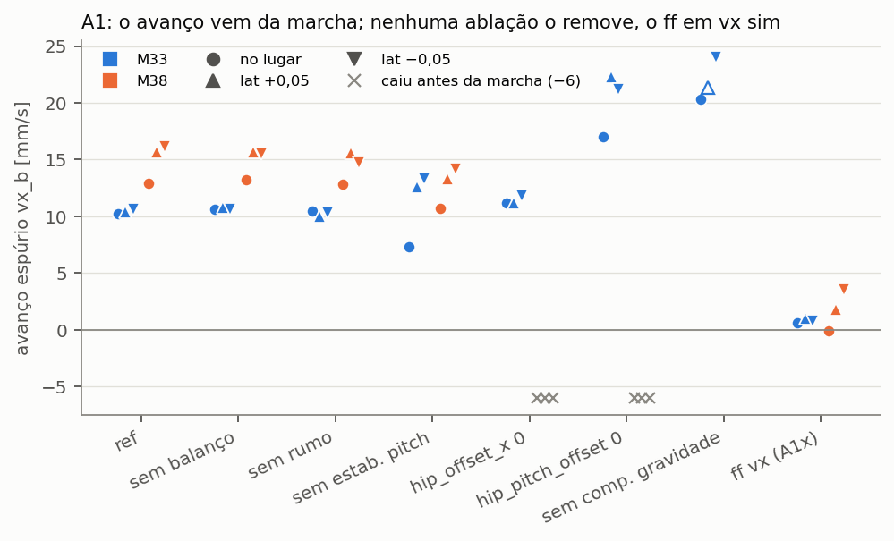
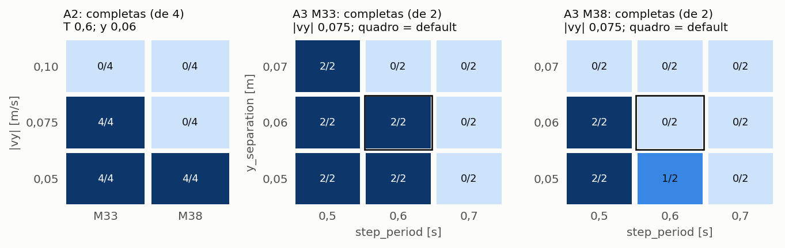
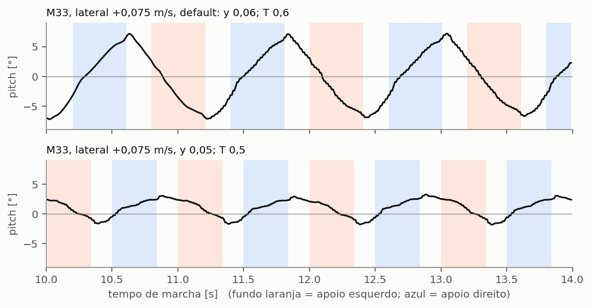

# Marcha só em y (caranguejo): por que sai torta e até que velocidade anda

> Estado: **pré-registro escrito antes dos dados** (2026-11-13). Os resultados
> entram nas seções marcadas *Resultado*, sem alterar o que está acima delas.
> Plano: `~/.claude/plans/eu-quero-efetuar-uma-lexical-canyon.md`, Parte A.

**Respostas (2026-11-14, A1–A3x concluídas; os detalhes estão nas seções *Resultado*):**

| pergunta (§2) | resposta | onde |
|---|---|---|
| 1. De onde vem o avanço espúrio? | **Da marcha, não do lateral:** marchando no lugar o robô avança igual, +10 a +13 mm/s. É colocação do passo (99–108%). Nenhum fator do controlador explica; a correlação é com o pitch do tronco (r = −0,84). Um feedforward em vx (−0,010 / −0,015) o anula. | A1, A1x |
| 2. Até que \|vy\| anda? | Com os defaults: **M33 até 0,075, M38 até 0,05.** As quedas são todas para trás, por pitch: uma oscilação presa à fase, espelhada com o sentido. | A2 |
| 3. Os parâmetros de passo estendem? | **Sim:** `step_period` 0,5 + `y_separation` 0,05 elimina a oscilação e anda a ±0,09 nas duas massas (±0,10 no M33). A evidência aponta o período, não o comprimento do passo; pela letra da regra da A3x, o resultado é inconclusivo. Como default global, troca pitch por roll e **não passa no critério** (roll +11–46% em 4 de 8 movimentos). | A3, A3x |

## 1. Ponto de partida (fatos das campanhas E0–E7)

Fonte: `docs/marcha_omnidirecional.md` e `experiments/omni/resumo_omni.csv`.

- **Completa:** ±0,025 e ±0,05 m/s andam 30 s com roll nas duas massas (E5 8/8, E6 8/8, E7 32/32). Sem roll, ±0,05 cai em 8/8.
- **Mas sai torto:**
  - avanço espúrio em x de +0,007 a +0,019 m/s, **sempre para frente**;
  - erro de direção de 12–19° a 0,05 e de 26–34° a 0,025;
  - é o achado AA, nunca investigado.
- **O avanço não está no plano de passos.** Com vx = vψ = 0, o gerador põe dx = 0 (`OmnidirectionalWalkZMP.cpp:338-342`).
- **Nada acima de |vy| = 0,05 foi testado.** O teleop limita |vy| a 0,05.
- **Como o gerador anda de lado:** abre e fecha as pernas (mestrado do Maximo, p. 56).
  - A cada passo o tronco anda vy·T (0,03 m a 0,05 m/s, com T = 0,6 s).
  - No passo de abrir, os pés ficam a 2·ySep + 2·vy·T (0,18 m a 0,05 m/s); no de fechar, voltam a 2·ySep (0,12 m).
  - A única trava é o `limitTorso`, que impede o tronco de terminar a menos de ySep do pé de apoio.

**Fato novo da preparação (2026-11-13).** Medido com a métrica nova (§3) sobre corridas já gravadas da E7 com kd 0,06:

| corrida | vx_b | vx no ar | vx no chão |
|---|---|---|---|
| M33 lateral +0,05 | +0,0103 | +0,0111 | −0,0006 |
| M38 lateral −0,05 | +0,0152 | +0,0161 | −0,0010 |
| M33 giro +0,175 (sem translação comandada) | +0,0112 | +0,0113 | 0,0000 |
| M33 reta 0,10 | +0,1028 | +0,1027 | +0,0001 |

Valores em m/s, no frame do corpo, média dos dois pés.

- **O avanço espúrio acontece no ar:** o pé é colocado à frente. O escorregamento em apoio contribui com 0 a −1 mm/s.
- **O giro no lugar avança o mesmo ~1 cm/s.** Inferência: o avanço não é específico do lateral. Fica como hipótese a confirmar com a marcha no lugar (A1).

## 2. Perguntas

1. **De onde vem o avanço espúrio?** É do lateral ou de toda marcha sem translação comandada? Qual fator do controlador o produz? (A1)
2. **Até que |vy| o caranguejo anda 30 s?** (A2)
3. **Os parâmetros de passo (`y_separation`, `step_period`) estendem esse envelope?** (A3, condicional)

## 3. Método comum

**Configuração base (todas as corridas):**
- servo MX-28;
- `foot_collision:=box`;
- compensação de gravidade `hip_roll,knee` com ganho 0,3;
- `hip_pitch_offset_deg:=-5`;
- pitch com kp 0,2 / kd 0,06;
- malha de rumo ligada;
- roll quatorn K1 (kp 0,5 / kd 0,075 no quadril e no tornozelo);
- braços históricos (ombro aberto 50°, cotovelo 0, s = 1);
- `campo_livre.world`;
- 30 s.

**Massas:** M33 (`torso_mass_scale` 0,5, `z_com` 0,250, `hip_offset_x` 0,0036) e M38 (0,67 / 0,239 / 0,009).

**Métricas** (`analisar_omni.py`; janela de 3 s até o fim, ou até 0,5 s antes da queda):
- `vx_b`, `vy_b`: velocidade do CoM por passada, no frame do corpo;
- `vx_ar` / `vx_chao`, `vy_ar` / `vy_chao`: deslocamento dos pés, separado em colocação do passo e escorregamento;
- `erro_dir`, `razao_v`, `sep_min_mm`, `roll_rms_o`, `pitch_rms`;
- desfecho e direção da queda.

**Controle de qualidade:**
- uma corrida por condição (a simulação é quase determinística);
- RTF ≥ 0,85, senão a corrida é refeita (a original vai para `*_descartadas.csv`);
- os args são conferidos no `_launch.log`.

## 4. A1: diagnóstico do avanço espúrio (pré-registro)

**Desenho:** `experiments/lateral/desenho_A1.csv`, 42 corridas.
- Movimentos: marcha no lugar (0, 0, 0), lateral +0,05 e lateral −0,05.
- Massas: M33 e M38; pé D.
- Braços, com ablação de **um fator por vez** contra a ref:

| braço | o que muda |
|---|---|
| ref | configuração base |
| hpo0 | `hip_pitch_offset_deg:=0` |
| hx0 | `hip_offset_x` 0 |
| s0 | `arms_compensation_factor:=0` (sem balanço de braço) |
| gc0 | ganho da compensação de gravidade 0 |
| rumo0 | `heading_enabled:=false` |
| pitch0 | `stabilizer_enabled:=false` |

**Critério:**
- **Q1, o avanço é do lateral?** Comparo `vx_b` na marcha no lugar (ref) com o do lateral (ref), nas 2 massas. Se no lugar for ≥ 50% do lateral, conclui-se que o avanço é da marcha em si, não do lateral.
- **Q2, mecanismo:** a fração de `vx_b` explicada por `vx_ar` (colocação) contra `vx_chao` (escorregamento), na ref.
- **Q3, fator responsável:** um fator "explica" o avanço se a sua ablação reduz |`vx_b`| em ≥ 50% em relação à ref **nas 6 combinações** (3 movimentos × 2 massas) em que as duas corridas têm métrica.
  - Com 6 pares, o teste do sinal só atinge p = 0,031 se os 6 concordam. É esse o limiar de "sistemático"; 5 de 6 é reportado como tendência.
  - Ablação que derruba o robô antes de 3,5 s não tem métrica; isso é registrado, não imputado.
- **Saída:** a proposta de correção vai para o usuário decidir. Ela é a mudança do fator responsável, ou, se nenhum explicar, uma compensação de vx em malha aberta (comandar vx = −avanço medido). Nada muda de default sem o aval dele.

### Resultado A1 (2026-11-13; `experiments/lateral/`, 42 corridas)

**Qualidade:** 36 corridas com RTF 0,999.
- As outras 6 são **M38 com `hpo0` ou `hx0`, que cai antes de a marcha começar**, na partida (desfecho `caiu_antes`).
- Isso já era conhecido do panorama: a 3,8 kg o −5° e o `hip_offset_x` são necessários para ficar em pé.
- **Essas 6 não têm métrica.** O registro é intencional, não imputo nada.

**vx_b [mm/s] por braço** (pé D; "caiu t" = queda em t s):

| braço | M33 lugar | M33 lat+ | M33 lat− | M38 lugar | M38 lat+ | M38 lat− |
|---|---|---|---|---|---|---|
| ref | +10,2 | +10,4 | +10,6 | +12,9 | +15,7 | +16,1 |
| hpo0 (`hip_pitch_offset` 0) | +17,0 | +22,3 | +21,2 | caiu antes | caiu antes | caiu antes |
| hx0 (`hip_offset_x` 0) | +11,2 | +11,2 | +11,8 | caiu antes | caiu antes | caiu antes |
| s0 (sem balanço de braço) | +10,6 | +10,8 | +10,6 | +13,2 | +15,7 | +15,5 |
| gc0 (sem compensação) | +20,3 | +21,3 (caiu 16,8) | +24,0 | caiu 5,1 | caiu 3,9 | caiu 4,3 |
| rumo0 (sem malha de rumo) | +10,5 | +10,0 | +10,3 | +12,8 | +15,6 | +14,7 |
| pitch0 (sem estabilizador de pitch) | +7,3 | +12,6 | +13,3 | +10,7 | +13,3 | +14,2 |

**Q1, o avanço é do lateral?** Não.
- Marchando no lugar (vx = vy = vψ = 0) o robô avança **+10,2 mm/s (M33) e +12,9 mm/s (M38)**.
- No lateral, ref: +10,4/+10,6 (M33) e +15,7/+16,1 (M38).
- Razão lugar/lateral de 0,97 e 0,81, acima do limiar de 0,5. **O avanço é da marcha, e o lateral só o torna visível como erro de direção.**
- Já se via o mesmo +11 mm/s no giro no lugar (§1). Na reta ele aparece como vx_b 0,1028 para 0,1 comandado.

**Q2, mecanismo:** **99–108% do avanço é colocação do passo**: o pé pousa à frente de onde saiu, com o pé no ar. O escorregamento em apoio vale de 0 a −8%. Nos 6 casos da ref, a soma dos pés bate com o CoM a ±0,2 mm/s.

**Q3, fator responsável:** **nenhum explica** (critério: redução ≥ 50% nas 6 combinações).
- **s0 e rumo0:** variam de −4% a +9% em 6 de 6. **O balanço de braço e a malha de rumo não causam o avanço.**
- **hx0:** −8 a −11% (piora levemente, 3 de 3 com métrica).
- **pitch0:** de −25% a +28%, sem padrão.
- **hpo0 e gc0:** **dobram** o avanço (−67% a −126%).

**Correlação, não pré-registrada, portanto exploratória:**
- Nas 33 corridas com métrica, **quanto mais o tronco inclina para trás, maior o avanço**: r = −0,84 entre `pitch_marcha` (pitch médio verdadeiro na marcha) e `vx_b`.
- hpo0 e gc0 deixam o tronco 3–8° para trás e são os que mais avançam.
- **Inferência, não verificada:** o avanço vem da postura em pitch durante o passo, e não de um termo do plano de passos, que tem dx = 0. O mecanismo exato não foi isolado.

**A1x, exploratória e rotulada post hoc** (12 corridas, RTF 0,999, todas completaram 30 s). Testei as duas correções candidatas:
- **ff:** compensação de vx em malha aberta, com `walk_velocity_x` = −(avanço medido na ref): −0,0104 (M33) e −0,0149 (M38).
- **hpo8:** `hip_pitch_offset_deg` −8, para testar a dose-resposta da correlação.

| M, movimento | vx_b ref → ff → hpo8 [mm/s] | erro de direção* ref → ff → hpo8 | pitch RMS ref → ff → hpo8 | pitch médio ref → hpo8 |
|---|---|---|---|---|
| M33 lugar | 10,2 → 0,6 → 7,5 | — | 1,76 → 1,72 → 6,36° | +1,7 → +6,4° |
| M33 lat +0,05 | 10,4 → 1,0 → 2,7 | −13,2 → −1,3 → −3,4° | 2,75 → 2,91 → 6,83° | +1,0 → +6,5° |
| M33 lat −0,05 | 10,6 → 0,8 → 4,9 | +13,5 → +1,0 → +5,7° | 2,66 → 2,92 → 6,79° | +1,0 → +6,5° |
| M38 lugar | 12,9 → −0,1 → 8,3 | — | 1,15 → 1,03 → 6,63° | +1,0 → +6,6° |
| M38 lat +0,05 | 15,7 → 1,8 → 5,6 | −19,5 → −2,3 → −7,2° | 2,44 → 2,61 → 6,74° | +0,3 → +6,6° |
| M38 lat −0,05 | 16,1 → 3,5 → 5,3 | +20,1 → +4,6 → +6,8° | 2,64 → 3,05 → 6,89° | +0,2 → +6,7° |

\* O erro é medido em relação ao lateral **pretendido** (0, vy), e não ao comando com a compensação. O `erro_dir` do `resumo_omni.csv` compara com o comando efetivo, que no ff inclui o vx negativo.

**Fatos:**
- **ff:** o avanço residual cai para −0,1 a 3,5 mm/s (redução de 78–100%) e **o erro de direção do caranguejo cai de 13–20° para 1–5°**. O custo é pitch RMS +0,15 a +0,4° no lateral e −0,04 a −0,12° no lugar. Roll RMS de −0,0 a +0,2°.
- **hpo8:** reduz o avanço menos (35–74%) e inclina o tronco **+6,5° para frente**, com pitch RMS ~6,8° (2,5×). É o mesmo padrão do x +5 mm da E7, que foi rejeitado. **Descartado.**

**Proposta para o usuário decidir** (nada foi mudado no default):
- **Compensar o avanço em malha aberta:** `walk_velocity_x` ≈ −0,010 m/s (M33) e ≈ −0,015 m/s (M38) quando o comando for lateral ou parado.
  - No teleop, isso seria um offset somado ao vx.
  - **Limitação:** o valor depende da massa e, provavelmente, da postura. É uma calibração, não a correção da causa.
- **Investigar a causa** (passo seguinte opcional): o deslocamento do tronco em relação ao pé de apoio durante o apoio simples, ligado à cedência das juntas e à postura em pitch.

## 5. A2: envelope de vy (pré-registro)

**Desenho:** `experiments/lateral/desenho_A2.csv`, 16 corridas.
- vy ∈ {±0,075; ±0,10} × pé {D, E} × massa {M33, M38}, na configuração base.
- Se ±0,10 completar as 8 corridas, roda também ±0,125 (8 corridas).

**Referência:** ±0,05 (E7 kd 0,06, 16/16) e ±0,025 (E6, 8/8).

**Critério:**
- vy "anda" numa massa se as 4 corridas (2 sentidos × 2 pés) completam 30 s;
- também registro `razao_v`, |`erro_dir`|, `sep_min_mm`, roll RMS e direção da queda.

### Resultado A2 (2026-11-13; `experiments/lateral/`, semente 20261117)

**Qualidade:**
- 16 corridas com RTF de 0,998 a 0,999, nenhuma falha de lançamento.
- **Reproduzir:** `python3 analisar_omni.py lateral && python3 analisar_a2.py`, com a saída em `lateral/analise_A2.txt`.

**Envelope** (pré-registro: 4/4 corridas completas em 30 s = "anda"):

| \|vy\| [m/s] | M33 | M38 |
|---|---|---|
| 0,05 (E7 kd06, referência) | 4/4 anda | 4/4 anda |
| 0,075 | **4/4 anda** | **0/4**: caem em 4,7–5,4 s, para trás |
| 0,10 | **0/4**: caem em 3,6–4,4 s, para trás | **0/4**: caem em 3,9–4,5 s, para trás |

±0,125 não foi rodado, porque ±0,10 não completou.

**Qualidade dentro do envelope** (M33):

| \|vy\| | `razao_v` | \|`erro_dir`\| | pitch RMS | roll RMS | `sep_min` | vx_b |
|---|---|---|---|---|---|---|
| 0,05 | 0,91–0,92 | 13–14° | 2,7–2,8° | 1,44–1,54° | 115 mm | +10 a +12 mm/s |
| 0,075 | 1,04–1,06 | 11–12° | **4,4–4,4°** | 1,71–1,75° | 117–118 mm | +16 a +17 mm/s |

**Fatos:**
- **As 12 quedas fora do envelope são todas para trás, por pitch.** Nenhuma é lateral, e `sep_min` nunca se aproxima de 90 mm. **O limite do caranguejo não é o roll nem a colisão dos pés; é o pitch.**
- **O lateral excita uma oscilação de pitch travada na fase do passo e espelhada com o sentido.** Saída em `lateral/diag_fase_pitch.py`, `diag_fase_pitch.txt`. Com +vy:
  - no apoio esquerdo, o pé que abriu, o tronco fica ~3° mais para trás que no direito (−3,2° M33, −2,5° M38 a 0,05);
  - com −vy, inverte (+3,0° e +2,3°);
  - no lugar, a diferença é 0,0°;
  - a oscilação de pitch (desvio padrão) cresce de 0,4° (lugar) e 0,7° (reta) para 2,6° (0,05) e 4,4° (0,075).
- Nas quedas, o estabilizador de pitch satura no limite de 10° em 30–44% do tempo antes da queda, que ocorre de 2 a 5 passos depois do início.
- **Nenhuma ablação da A1 remove a assimetria de fase** (`diag_fase_pitch.txt`):
  - fica entre 1,7° e 4,4° com `hip_pitch_offset` 0, `hip_offset_x` 0, sem balanço, sem compensação, sem malha de rumo e sem estabilizador de pitch;
  - o estabilizador de pitch a reduz de 3,2° para 1,7°, mas aumenta a oscilação total (2,6° → 3,6°).
- **A hipótese de erro da IK/cadeia foi refutada.**
  - Por FK do URDF com os **set-points**, a orientação comandada de cada pé em relação ao tronco é a mesma no lugar, em +vy e em −vy: pé de apoio −7,6°, pé em balanço −4,0° em pitch. O caso é M33, sem estabilizador de pitch.
  - Com os **valores realizados**, o pé de apoio do lado que abriu fica em −0,7° com +vy e apoio E, contra −2,7° no lugar. **A assimetria nasce entre o comando e o realizado.**
- **Inferência, não verificada:** a perna que recebe o corpo no passo de abertura carrega o tronco com aceleração lateral e cede ~2° a mais em pitch. É o mesmo mecanismo de cedência que faz o tronco "pender" com a massa (`docs/panorama_parametros.md`; `docs/README.md`, "cedência dos servos cresce com a carga e inclina para trás"). O passo maior (vy·T) aumenta a carga, e a M38, mais pesada, cede antes.

A figura mostra o pitch verdadeiro, M33 a +0,075: com o default, a oscilação é de ±7° travada na passada; com y 0,05 e T 0,5 (A3), de ±2°.

**Consequência para a A3** (regra pré-registrada): roda em **|vy| = 0,075**, o menor que não anda numa das massas (M38). A grade de `y_separation` × `step_period` testa se um passo mais curto ou mais largo reduz essa carga.

## 6. A3: parâmetros de passo (pré-registro; condicional)

**Onde roda:** no menor |vy| que não anda na A2, numa das massas; ou em 0,10 se tudo andar.

**Desenho:** `y_separation` {0,05; 0,06; 0,07} × `step_period` {0,5; 0,6; 0,7} × ±vy × 2 massas, pé D: 36 corridas.

**Critério, nesta ordem:**
1. sobrevivência (completou 30 s);
2. |`erro_dir`|;
3. roll RMS.

**Vetos:** `sep_min` < 90 mm em alguma corrida, ou pitch RMS > +10% contra (0,06; 0,6).

Uma troca de default só com o aval do usuário.

### Resultado A3 (2026-11-14; `experiments/lateral/`, |vy| = 0,075, semente 20261118)

**Qualidade:**
- 36 corridas com RTF de 0,983 a 0,998, nenhuma falha de lançamento.
- Desenho gerado por `lateral/gerar_A3.py 0.075`.
- **Reproduzir:** `python3 analisar_omni.py lateral && python3 analisar_a3.py`, com a saída em `lateral/analise_A3.txt`.

**Corridas completas, de 2 (±vy):**

| `y_separation` \ `step_period` | M33 0,5 | M33 0,6 | M33 0,7 | M38 0,5 | M38 0,6 | M38 0,7 |
|---|---|---|---|---|---|---|
| 0,05 | **2/2** | 2/2 | 0/2 | **2/2** | 1/2 | 0/2 |
| 0,06 (default) | 2/2 | 2/2 (ref.) | 0/2 | 2/2 | 0/2 (ref.) | 0/2 |
| 0,07 | 2/2 | 0/2 | 0/2 | 0/2 | 0/2 | 0/2 |

**Todas as 24 quedas são para trás, por pitch.**

**Qualidade nas células que completam:**

| massa | y; T | \|`erro_dir`\| | pitch RMS | oscilação de pitch | assimetria de fase E − D* | roll RMS | vx_b [mm/s] | `sep_min` |
|---|---|---|---|---|---|---|---|---|
| M33 | 0,06; 0,6 (default) | 11,8° | 4,44° | 4,4° | −4,8° | 1,80° | +16 | 118 mm |
| M33 | 0,06; 0,5 | 3,4° | 2,11° | 1,9° | −0,5° | 1,19° | +4 | 118 mm |
| M33 | **0,05; 0,5** | **1,9°** | **1,81°** | **1,4°** | **−0,3°** | **1,19°** | **+2** | 97 mm |
| M38 | 0,05; 0,5 | 12,7° | 1,16° | 1,1–1,2° | −0,7° | 1,25° | +14 a +16 | 99 mm |
| M38 | 0,06; 0,5 | 15,4° | 1,80° | 1,7–1,8° | — | 1,32° | +17 a +19 | 120 mm |

\* Com +vy (`lateral/diag_fase_pitch.py`).

**Regra pré-registrada:** a melhor célula sem veto é **y 0,05; T 0,5** nas duas massas. Nenhuma célula aciona veto (`sep_min` ≥ 96,6 mm; o veto de pitch na M38 não é avaliável, porque a referência caiu).

**Fatos:**
- **O período é o fator dominante:**
  - com T = 0,5, 6 de 6 células completam na M33 e 4 de 6 na M38;
  - com T = 0,7, 0 de 12;
  - a `y_separation` menor ajuda em segundo plano.
- **Com T = 0,5, a oscilação de pitch travada na fase (§5) praticamente some.** A assimetria cai de −4,8° para −0,3/−0,5°, e a oscilação de 4,4° para 1,4°. É o mecanismo que derrubava a marcha.
- **Na M33, o avanço espúrio cai junto, de +16 para +2 mm/s**, e o |`erro_dir`| de 12° para 2°. **Na M38, não cai** (+14 a +19 mm/s): o avanço da M38 tem outra componente, que a A3 não resolve.
- **Custos:**
  - `razao_v` cai de 1,04–1,08 para 0,89–0,91, isto é, anda ~10% menos que o comando;
  - com y 0,05, a `sep_min` fica em 97–99 mm, a 7–9 mm do veto de 90.

**Limitações** (não extrapolar):
1. **T = 0,5 é a borda da grade.** O ótimo pode estar abaixo, e não testei.
2. **O vy é fixo (0,075), então período e comprimento de passo (vy·T) andam juntos:** 37,5 mm com T 0,5, 45 mm com 0,6 e 52,5 mm com 0,7. **Não dá para dizer se o que importa é a frequência do passo ou o comprimento do passo.**
3. **Só o lateral foi testado.** Trocar `step_period` muda a marcha inteira (reta, giro, curva), e nada disso foi verificado com T 0,5.

**Inferência, não verificada:**
- **Duas explicações possíveis:**
  - o passo mais curto reduz a carga que a perna de abertura recebe, coerente com a cedência proposta em §5;
  - ou a frequência de 1 Hz por passada (T 0,5) se afasta de um modo de pitch do corpo que a de 0,83 Hz (T 0,6) excita.
- **Um teste separa as duas:** T 0,5 com vy 0,09 dá o mesmo passo de 45 mm do default a 0,075.

**Proposta para o usuário decidir.** Nada foi mudado no default.
- `step_period` 0,5 e `y_separation` 0,05 **só para comando lateral**.
- Ou, como default geral, **depois de validar** reta, giro e curva com T 0,5 (ver §7).

## 7. A3x: frequência ou comprimento, e validação de T 0,5 (exploratória; pré-registro)

> Rotulada **post hoc**: foi desenhada depois de ver a A3, e não muda nenhuma conclusão pré-registrada. Critérios escritos em 2026-11-14, antes de qualquer corrida da A3x. Configuração base, pé D.

**(a) Dissociação.** São 8 corridas, `lateral/desenho_A3x.csv`, tags `A3x_<M>_lat<vy>_y<ys>_T<T>`:

| condição | comprimento do passo vy·T | igual a | anda quando importa a frequência | anda quando importa o comprimento |
|---|---|---|---|---|
| y 0,05, **T 0,5**, vy ±0,09 | 45 mm | default com 0,075 | sim | não (assimetria alta) |
| y 0,05, **T 0,6**, vy ±0,0625 | 37,5 mm | A3 vencedora | não (assimetria alta) | sim |

× 2 massas.
- **Leitura:** completar 30 s e a assimetria de fase (E − D, `diag_fase_pitch.fase`).
- Assimetria |E − D| < 1,5° conta como "baixa"; > 3° conta como "alta".
- Se o resultado não cair em nenhuma das duas colunas, ou for misto entre as massas, reporto como **inconclusivo**.

**(b) Validação de y 0,05 / T 0,5 fora do lateral.** São 12 corridas:
- {lugar, reta 0,1, giro +0,175, curva +0,175, lateral +0,10, lateral −0,10} × 2 massas.
- **Referência:**
  - B1 P0 s1, a configuração base com T 0,6 e y 0,06: reta, giro e curva;
  - A1 ref: lugar;
  - A2: lateral ±0,10, que caiu nas duas massas.
- **Critério (descritivo, n = 1 por célula):**
  - "não prejudica" se completa e o pitch RMS e o roll RMS não passam de +10% contra a referência;
  - para giro e curva, também |ω/ω_cmd − 1| ≤ referência + 0,02.
- A curva +0,175 não está na B1; a referência dela é a E7 kd06 `curva+0.175_pD`, a mesma configuração base (a regressão 0c mostrou que os defaults reproduzem a E7).

### Resultado A3x (2026-11-14; `experiments/lateral/`, semente 20261121)

**Qualidade:**
- 20 corridas com RTF 0,999.
- 19 completaram 30 s; a exceção é M38 lat +0,10.
- **Reproduzir:** `python3 analisar_omni.py lateral && python3 analisar_a3x.py`; a saída está em `lateral/analise_A3x.txt`.

#### (a) Dissociação

| massa | condição | passo vy·T | completou | E − D (+vy / −vy) | oscilação | vx_b [mm/s] |
|---|---|---|---|---|---|---|
| M33 | T 0,5, vy ±0,09 | 45 mm | 2/2 | −0,33 / +0,68 | 2,0 | +1,2 / +1,9 |
| M33 | T 0,6, vy ±0,0625 | 37,5 mm | 2/2 | −2,86 / +3,04 | 2,5 | +9,3 / +9,3 |
| M38 | T 0,5, vy ±0,09 | 45 mm | 2/2 | −0,83 / +0,84 | 1,8–1,9 | +15,8 / +16,3 |
| M38 | T 0,6, vy ±0,0625 | 37,5 mm | 2/2 | −2,35 / +2,40 | 2,5–2,8 | +16,7 / +15,4 |

**Leitura pela regra pré-registrada:**
- A linha **T 0,5** cai na coluna "frequência" nas duas massas: completou, com assimetria baixa (|E − D| ≤ 0,84 < 1,5).
- A linha **T 0,6** completou, mas com assimetria **intermediária** (2,35 a 3,04°). Ela não é "baixa", como prevê a coluna "comprimento", nem fica "alta" de forma clara. Só um dos quatro valores passa de 3°.
- **Pela letra da regra, o conjunto é, portanto, inconclusivo.**

**Fatos que a regra não captura:**
- **Com o passo mais longo (45 mm) e T 0,5, a assimetria fica baixa.**
  - A hipótese do comprimento previa o contrário, porque esse passo é o mesmo do default a 0,075, onde a assimetria era ~5°.
  - A linha T 0,5 sozinha **refuta "o comprimento do passo causa a oscilação"**.
- **Com o passo mais curto (37,5 mm) e T 0,6, a assimetria fica perto da do default a 0,05** (passo de 30 mm, E − D ±3,0–3,2°, Resultado A2): encurtar o passo com T 0,6 não a reduz.
- A ±0,09, as duas massas completam com T 0,5. Isso **estende o envelope** além do que a A3 testou (0,075).

**Inferência, não verificada:** a oscilação de pitch presa à fase depende do **período do passo**, e não do comprimento. Isso é compatível com uma ressonância do tronco com a cedência das juntas (A2), mas o mecanismo não foi isolado.

**Fato secundário:** com T 0,5, o avanço espúrio da M33 praticamente some (vx_b +0,2 a +2,5 mm/s, inclusive a ±0,10). Com T 0,6 e y 0,05 ele fica em +9,3. **Na M38 não muda** (+14 a +16 com T 0,5 e com T 0,6).

#### (b) Validação de y 0,05 / T 0,5 fora do lateral

Valores da referência → novo:

| massa, movimento | completou | pitch RMS | roll RMS | outro | regra |
|---|---|---|---|---|---|
| M33 lugar | sim → sim | 1,76 → 1,70 (−4%) | 0,96 → 1,25 (**+30%**) | | prejudica |
| M33 reta 0,1 | sim → sim | 2,00 → 1,58 (−21%) | 1,14 → 1,26 (**+11%**) | vx_b 103,0 → 97,6 mm/s | prejudica |
| M33 giro +0,175 | sim → sim | 2,70 → 1,72 (−37%) | 1,30 → 1,33 (+2%) | \|ω/ω_cmd − 1\| 0,000 → 0,002 | não prejudica |
| M33 curva +0,175 | sim → sim | 2,13 → 1,77 (−17%) | 1,46 → 1,27 (−13%) | 0,001 → 0,005 | não prejudica |
| M33 lat ±0,10 | 0/2 → **2/2** | — | — | \|erro_dir\| 0,1–1,6° | melhora |
| M38 lugar | sim → sim | 1,15 → 0,78 (−32%) | 0,98 → 1,42 (**+46%**) | | prejudica |
| M38 reta 0,1 | sim → sim | 1,76 → 1,20 (−32%) | 1,11 → 1,20 (+8%) | vx_b 104,6 → 103,6 | não prejudica |
| M38 giro +0,175 | sim → sim | 2,63 → 1,03 (−61%) | 1,30 → 1,48 (**+14%**) | 0,005 → 0,001 | prejudica |
| M38 curva +0,175 | sim → sim | 1,74 → 1,29 (−26%) | 1,46 → 1,34 (−8%) | 0,002 → 0,004 | não prejudica |
| M38 lat ±0,10 | 0/2 → **1/2** | — | — | +0,10 cai em 24,7 s, para trás | melhora parcial |

**Fatos:**
- **Pelo critério pré-registrado, y 0,05 / T 0,5 prejudica 4 dos 8 movimentos fora do lateral.** Em todos, o motivo é o **roll RMS**, de +11% a +46%.
- **O pitch RMS cai em todos os 8**, de −4% a −61%.
- **Nenhuma corrida fora do lateral cai**, e o rumo e o giro ficam iguais (|ω/ω_cmd − 1| ≤ 0,005).
- **No lateral a ±0,10**, onde a configuração base cai nas 4 corridas, a nova completa 3 de 4.
- **Em valor absoluto,** o roll RMS mais alto fora do lateral é 1,48°, contra 0,96–1,46° na base.

**Inferências, não verificadas:**
- **É uma troca, não uma melhora pura:** menos pitch e mais roll.
  - Neste estudo, quase todas as quedas sem empurrão foram para trás, por pitch: A2 12/12, B2 18/20, B2x 15/19. Por isso a troca *pode* ser favorável.
  - O critério pré-registrado, porém, não a aprova como default global, e eu não o reinterpreto.
- **n = 1 por célula, sem replicação de pé.** Os +10% do critério estão perto do ruído entre corridas em alguns movimentos.

**Proposta para o usuário decidir** (nada mudou no default):
- **Lateral (|vy| > 0,05):** usar `step_period:=0.5 y_separation:=0.05`.
  - Com isso o lateral anda até ±0,09 nas duas massas e ±0,10 no M33.
  - Ele tem a menor assimetria e, no M33, quase sem avanço espúrio.
  - O `step_period` é lido na partida (`controller.cpp`, junto dos parâmetros de marcha). Usar T 0,5 só no lateral exige reiniciar a marcha com o parâmetro.
- **Como default global:** **não recomendado** pelo critério (roll +11–46% em 4 de 8). Para decidir, seria preciso uma campanha com replicação (2 pés × 2 sentidos) nos movimentos que falharam.
