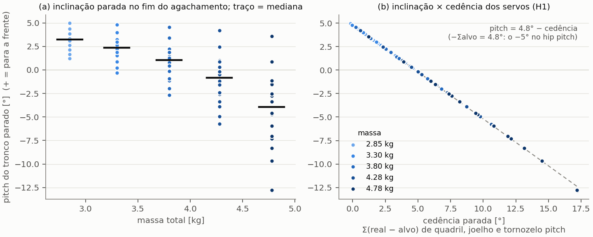
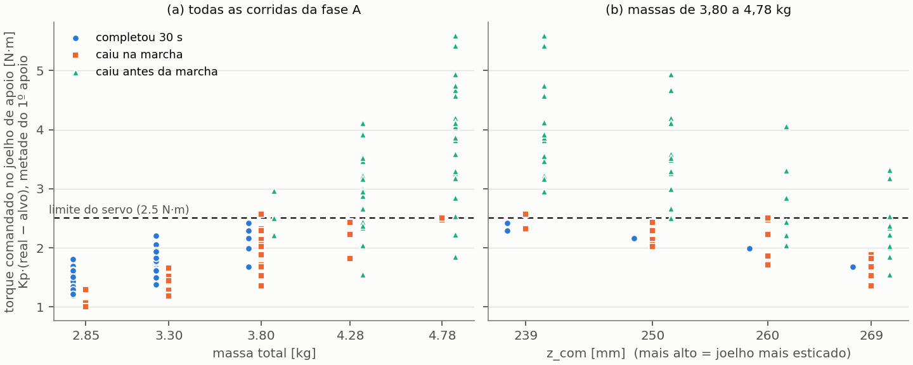
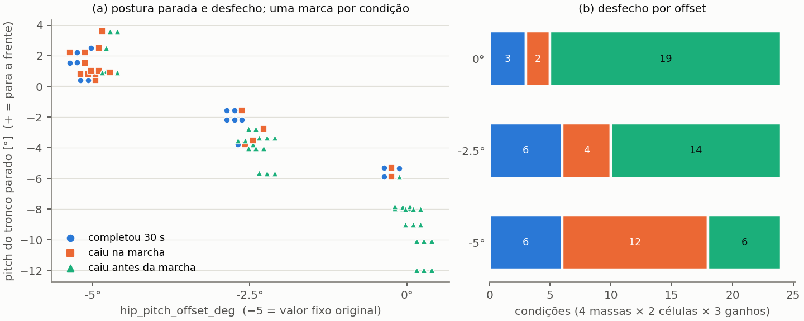
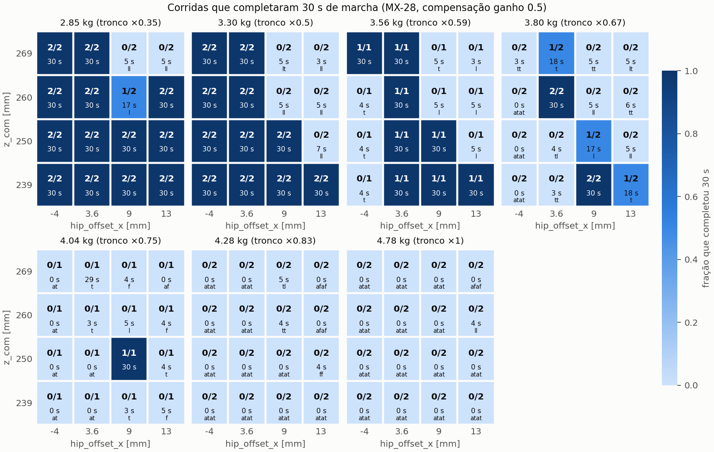
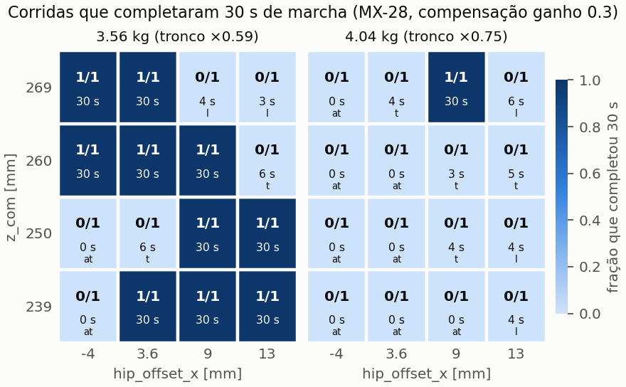

# Panorama de parâmetros da marcha × massa (servo MX-28, outubro de 2026)

> Parte de [README.md](README.md). Continua
> [ajustes_marcha.md](ajustes_marcha.md) (§ Compensação de gravidade).
>
> - Dados: `src/marta_bringup/experiments/panorama/`.
> - Análise: `analisar_panorama.py`.
> - Figuras: `fig_panorama.py`.
>
> 354 corridas de 30 s (3 de piloto e 351 nas fases A a E), em 2026-10-28,
> das 00:17 às 06:35.

> **Consulta rápida** (que parâmetros usar num robô com outras especificações):
> [consulta_parametros.md](consulta_parametros.md) e
> `experiments/consulta_parametros.py`.

## Resumo

1. **Com o MX-28 e a geometria atual, a Marta anda até ~3,6 kg.**
   - 2,85 kg: 13 de 16 combinações de `z_com` × `hip_offset_x` andam;
   - 3,30 kg: 11/16;
   - 3,56 kg: 8–10/16;
   - 3,80 kg: 2/16;
   - 4,04 kg: 1/16;
   - 4,28 e 4,78 kg: 0/16, em qualquer combinação.

   Em termos transferíveis, o índice de carga m·g·L/stall precisa ficar abaixo
   de ~2,6 para uma janela ampla. Entre 2,7 e 2,9 é borda (ver Receita).
2. **O tronco "pende" com a massa por cinemática, não por CoM.** Os eixos
   pitch da perna são paralelos, então o pitch do tronco vale
   (−Σ alvo) − (cedência somada dos servos). Isso fecha com resíduo de 0,02°.
   O −Σ alvo é +4,8°, vindo de um **−5° fixo no hip pitch** do gerador, e
   inclina o tronco para a frente. A cedência cresce com a carga e o inclina
   para trás. Tronco leve pende para a frente; tronco pesado, para trás.
3. **As massas pesadas caem porque o joelho de apoio satura.** O torque que o
   servo comanda passa de 2,5 N·m já na metade do 1º apoio simples, antes de
   o tronco cair. Nenhuma célula saturada da fase A andou (Fisher
   p = 2×10⁻¹², 80 células). A compensação de gravidade não resolve isso,
   porque não cria torque. O que reduz a demanda é esticar a perna.
4. **O ganho da compensação escolhe a direção da queda, mas não salva as
   massas pesadas.** Nas massas pesadas, ganho 0,3 cai para trás, 0,5 de lado
   e 0,7 para a frente. Em sobrevivência, 0,3 e 0,5 empatam, e 0,7 é pior.
5. **O −5° é necessário no código atual.** A compensação só entra no 1º passo,
   com rampa de 1 s; parado, a cedência não é compensada. Sem o −5°, o robô
   fica até 12° inclinado para trás e cai antes de andar: de 6/24 para 19/24
   condições (Fisher p = 4×10⁻⁴).
6. **As hipóteses alternativas não explicam o "pender":**
   - altura do CoM × `com_swing_factor` (H2): sem efeito;
   - estabilizador de pitch (H3): o pitch parado é idêntico com ele desligado.
     Ele ajuda a andar (sem ele, o pitch RMS sobe e 2 de 5 condições caem),
     mas não causa o pender.
7. **Nas massas leves, quem derruba é o roll.** Das quedas durante a marcha,
   52 de 102 corridas foram de lado. Elas aumentam com `z_com` alto e com
   `hip_offset_x` grande.

## Perguntas

1. **Quais combinações de parâmetros andam, para cada massa?** A Marta nova
   será mais leve e terá outro `z_com`.
2. **Por que o robô pende para a frente ou para trás quando se muda o
   `torso_mass`?** Escalar o tronco move o CoM total menos de 0,2 mm em x
   (modelo estático, `gravidade/modelo_gravidade.py`). O deslocamento do CoM,
   portanto, não explica.

Hipóteses para a pergunta 2, registradas no plano antes dos dados:

| | hipótese |
|---|---|
| H1 | cedência dos servos proporcional à carga |
| H2 | altura do CoM contra o `tZMP` fixo do LIPM |
| H3 | ganhos fixos do estabilizador de pitch |
| H4 | saturação de torque |

## Método

### Condições fixas

- **Servo MX-28 realista:**
  - p = 12,74 N·m/rad (`controller_mx28.yaml`);
  - amortecimento implícito 0,43;
  - limite de 2,5 N·m;
  - `joint_velocity` 100.
- **Compensação de gravidade:** ligada em `hip_roll,knee`.
- **Pé:** em caixa.
- **Estabilizador de pitch e malha de rumo:** ligados, salvo na fase D.
- **Marcha padrão:** período 0,6 s, apoio duplo 0,3, `z_step` 0,08, `y_sep`
  0,06.
- **Ensaio:** 30 s a 0,1 m/s.

Uma simulação por vez; a ordem é embaralhada com semente registrada no log de
cada fase. Nenhuma corrida teve RTF abaixo de 0,85 (medido até a queda), e
nenhuma falhou.

### Fatores e níveis

| fator | níveis | observação |
|---|---|---|
| massa (escala do tronco) | 0,35 / 0,5 / 0,59 / 0,67 / 0,75 / 0,83 / 1,0 | 2,85 / 3,30 / 3,56 / 3,80 / 4,04 / 4,28 / 4,78 kg; conferido em `total_mass` |
| `z_com` (altura do tronco na IK) | 0,239 / 0,250 / 0,260 / 0,269 m | joelho-alvo parado: 82 / 73 / 63 / 53° |
| `hip_offset_x` | −0,004 / 0,0036 (URDF) / 0,009 / 0,013 m | |
| ganho da compensação | 0,3 / 0,5 / 0,7 | |
| `hip_pitch_offset_deg` | −5 (original) / −2,5 / 0 | exposto como parâmetro nesta bateria |

### Fases

| fase | o que varia | corridas |
|---|---|---|
| A, mapa | 5 massas × 4 `z_com` × 4 `hip_offset_x`; ganho 0,5; n = 2 | 160 |
| B, ganho | ganho {0,3; 0,5; 0,7} × 5 massas, na melhor célula de A; n = 3 | 45 |
| C, grade fina | massas 3,56 e 4,04 kg × 16 células × ganho {0,3; 0,5}; n = 1 | 64 |
| D, H2/H3 | `com_swing_factor` casado (8 condições); estabilizador desligado (10 condições); n = 1, contra as mesmas células de A | 18 |
| E, −5° | `hip_pitch_offset_deg` × ganho × 4 massas × 2 células, n = 1. O braço −5° da 1ª célula é a fase B | 64 |

A melhor célula de A, usada em B e E, foi escolhida por massa com esta
ordem de critérios: conclusões, sobrevida, conclusões dos 4 vizinhos e menor
torque no 1º apoio.

O desenho foi ajustado no caminho. As mudanças estão registradas, com
motivo, no plano da bateria, e os desenhos cancelados ficam como
`panorama/desenho_*_cancelado.csv`:

- **Fase C:** passou de repetições nas bordas para uma grade fina de massa,
  por causa do determinismo (ver abaixo).
- **Fase E:** foi incluída, a pedido, quando o −5° apareceu como causa.

### A simulação é quase determinística

Isso muda a estatística. Em 83 de 95 células com repetição, todas as
repetições deram o mesmo desfecho e a mesma direção de queda. A diferença
máxima de pitch parado entre repetições de uma célula ficou em 0,002° de
mediana (máximo de 0,07°). As repetições só divergem em células sensíveis,
perto das bordas.

Por isso, **toda a estatística deste documento é por condição (célula)**:
- uma observação por célula, a média ou a maioria das suas corridas;
- Fisher para desfechos, Spearman para tendências.

Contar corridas como amostras independentes seria pseudorreplicação. Isso
vale também para os "n = 3" e "1/3" das campanhas anteriores
([ajustes_marcha.md](ajustes_marcha.md)).

### Desfechos e métricas

**Desfechos:**
- **completou:** andou os 30 s;
- **caiu antes da marcha:** caiu nos passos no lugar que precedem a marcha
  medida;
- **caiu na marcha.**

A direção da queda é dada pelo sinal do pitch verdadeiro ao passar de 45°;
queda por roll conta como "de lado".

**Métricas:**
- **Janela parada:** o último 1 s antes do 1º passo, no fim do agachamento.
  A compensação não atua nela (Δ = 0 nos dados).
- **Torque no 1º apoio:** o comando do joelho de apoio, Kp·(real − alvo), na
  metade do 1º apoio simples. O alvo já inclui o Δ. É medido antes da queda,
  para não tomar efeito por causa.

`registrar_pe.py` grava alvo, ângulo real, Δ e verdade de solo no mesmo
instante. É a única fonte que cobre as quedas antes da marcha: o bag do
`walk_test` começa depois delas.

## Resultado 1: o "pender" é cinemático (H1 confirmada)



Os eixos de pitch do quadril, do joelho e do tornozelo são paralelos (todos
+y no URDF). Com o pé plano, então:

```
pitch_tronco = pitch_pé − Σ alvo − Σ (real − alvo)      (quadril, joelho e tornozelo pitch)
```

A identidade fecha nos dados:
- **parado:** resíduo máximo de 0,02°, nas 160 corridas da fase A;
- **na marcha:** resíduo máximo de 0,09°, na perna de apoio em apoio simples
  (58 corridas).

Com ela, cada termo pode ser atribuído:

| massa (fase A, 16 células) | pitch parado: mediana [mín; máx] | cedência somada: mediana |
|---|---|---|
| 2,85 kg | +3,2° [+1,2; +5,0] | 1,6° |
| 3,30 kg | +2,4° [−0,3; +4,8] | 2,4° |
| 3,80 kg | +1,0° [−2,7; +4,5] | 3,8° |
| 4,28 kg | −0,8° [−5,7; +4,2] | 5,6° |
| 4,78 kg | −4,0° [−12,8; +3,6] | 8,8° |

(+ = tronco para a frente)

**O que os dados mostram:**
- **O alvo somado é −4,8° em todas as corridas** (de −4,90 a −4,77°). A IK
  sozinha daria 0, porque fecha o triângulo da perna. Os −4,8° vêm de
  `joints.{left,right}HipPitch -= 5°` em `OmnidirectionalWalkZMP.cpp`
  ("ajuste fino na postura para evitar sobrecarga nos quadris", commit
  "testando o controle sem a Marta cair para frente"). Com servos ideais, o
  tronco ficaria **+4,8° para a frente**.
- **A cedência somada cresce com a massa** (Spearman ρ = 0,71,
  p = 2×10⁻¹³, 80 células). O joelho responde pela maior parte, mediana de
  89%.
- **Cada grau de cedência inclina o tronco um grau para trás:**
  pitch = −1,000 × cedência + 4,81°, R² = 0,9998.
- **Dentro de uma mesma massa, a postura mais agachada cede mais** e pende
  mais para trás. É isso que espalha os pontos do painel (a).

**Conclusão.** Mudar o `torso_mass` muda a carga, a carga muda a cedência, e
a cedência muda o pitch, grau por grau. Com tronco leve, vence o −5° e o robô
pende para a frente. Com tronco pesado, vence a cedência e ele pende para
trás.

O −5° e o `hip_offset_x` 0,013 antigo são ajustes empíricos do mesmo tipo:
compensam uma cedência que na época ninguém media.

## Resultado 2: por que as massas pesadas caem (H4 confirmada)



**Como caem.** Com 4,28 e 4,78 kg, a fase A teve 0 de 64 corridas
completas. Das 64, 56 caíram antes da marcha, 50 delas para trás. A sequência
típica, em ~1 s:
1. No 1º apoio simples, o joelho de apoio cede de ~5° para ~14° em 0,4 s.
2. Pela identidade, o tronco vai a −16°.
3. No 2º apoio, o joelho cede mais de 30°, e o robô cai para trás.

**Torque comandado no joelho de apoio, na metade do 1º apoio:**

| fase A, por célula (maioria) | células | torque médio ≥ 2,5 N·m |
|---|---|---|
| caiu antes da marcha | 31 | 23 |
| não caiu antes (completou ou caiu na marcha) | 49 | 1 |

Fisher p = 2×10⁻¹². **Nenhuma célula saturada completou.**

Por corrida, em todas as fases:
- só 1 das 117 corridas completas passou de 2,5 N·m (2,69 N·m);
- nas 117 corridas completas, o joelho de **apoio** satura em 0,17% do tempo
  de apoio simples (no máximo 3,8%, numa corrida de 3,80 kg). O de
  **balanço** satura em 45% do tempo de balanço. A saturação no balanço
  atrasa o pé, mas não derruba.

**Conclusão.** Acima de ~3,8 kg, o joelho de apoio pede mais torque do que o
MX-28 entrega, e o robô desaba. A compensação de gravidade não resolve: ela
desloca o alvo, mas o torque continua limitado a 2,5 N·m.

**O que reduz a demanda é esticar a perna** (`z_com` contra torque, por
célula: ρ = −0,46, p = 1,5×10⁻⁵). A alavanca efetiva do joelho de apoio,
b = τ/(m·g), medida nas massas leves:

| joelho-alvo parado (`z_com`) | b |
|---|---|
| 82° (0,239) | ~59 mm |
| 73° (0,250) | ~53 mm |
| 63° (0,260) | ~47 mm |
| 53° (0,269) | ~40 mm |

Nas massas pesadas, b cresce, porque a cedência dobra mais o joelho: é uma
realimentação positiva.

O critério de torque é **necessário, mas não suficiente**:
- 8 das 31 células que caíram antes da marcha não estavam saturadas, e a
  queda precoce mais baixa ocorreu com 1,55 N·m;
- esticar a perna tem custo: mais quedas de lado (Resultado 4).

## Resultado 3: o −5° e o ganho (fases B e E)



### Fase B: o ganho escolhe a direção da queda

| massa | célula (`z_com`; x) | ganho 0,3 | ganho 0,5 | ganho 0,7 |
|---|---|---|---|---|
| 2,85 kg | 0,250; 0,0036 | 3/3 | 3/3 | 3/3 |
| 3,30 kg | 0,250; 0,0036 | 3/3 | 2/3 | 1/3 |
| 3,80 kg | 0,239; 0,009 | 3/3 | 3/3 | 0/3 (de lado) |
| 4,28 kg | 0,269; 0,009 | 2/3 (1 para trás) | 0/3 (de lado) | 0/3 (para a frente, antes) |
| 4,78 kg | 0,260; 0,013 | 0/3 (para trás, antes) | 0/3 (2 de lado, 1 para a frente) | 0/3 (para a frente, antes) |

- **O ganho inclina o tronco para a frente na marcha.** É a mesma identidade
  de antes: a compensação anula a cedência, e o −5° fica sem contrapeso. Com
  ganho 0,7, o Δ supera a cedência. O pitch médio em apoio simples:

  | ganho (2,85 a 3,80 kg) | pitch médio |
  |---|---|
  | 0,3 | ~1–2° |
  | 0,5 | ~4–5° |
  | 0,7 | ~6–7° |

  Correlação ganho × pitch: ρ = 0,75, p = 0,02, 9 células. Exceção:
  4,28 kg com ganho 0,3 anda com 6°, porque na postura esticada a cedência
  residual é pequena.
- **Nas massas pesadas, a direção da queda segue o ganho.** Com 0,3, para
  trás; com 0,7, para a frente, todas antes da marcha.
- **Em sobrevivência, 0,3 e 0,5 empatam.** Nos pares de células com os dois
  ganhos (fases B e C): só 0,3 anda em 5, só 0,5 anda em 2, empatam 30
  (binomial p = 0,45). O ganho 0,7 é pior: só 0,5 anda em 2 pares, só 0,7 em
  nenhum.

### Fase E: tirar o −5° piora

A fase E tem 72 condições: 4 massas (3,30 a 4,78 kg) × 2 células × 3 ganhos ×
3 valores do −5°.

| `hip_pitch_offset_deg` | pitch parado, mediana | completou | caiu na marcha | caiu antes |
|---|---|---|---|---|
| −5 (original) | +1,3° | 6 | 12 | 6 |
| −2,5 | −3,4° | 6 | 4 | 14 |
| 0 | −8,0° | 3 | 2 | 19 |

As três últimas colunas contam condições (24 por linha), pela maioria das
corridas. A direção das quedas antes da marcha, contada por corrida:
- −5: 9 para a frente e 3 para trás;
- −2,5: todas as 15 para trás;
- 0: todas as 21 para trás.

Quedas antes da marcha, −5 contra 0: Fisher p = 4×10⁻⁴ (por condição).

- **Sem o −5°, o robô já começa inclinado para trás.** Ele cai nos primeiros
  passos, antes de a compensação entrar.
- **O motivo está no controlador** (`LegGravityCompensation`): a compensação
  só é aplicada a partir do 1º passo, com rampa de 1 s (`RAMP_TIME`). No
  agachamento e parado, o Δ é zero.
- **O −5° funciona, na prática, como compensação estática da cedência**
  nessa fase. Com −2,5°, 3,30 kg anda ereto (pitch ~0,3–0,6° com ganho 0,5),
  mas não anda mais que com −5°.

**Conclusão.** No código atual, o −5° deve ficar.

**Hipótese não testada:** com a compensação ligada desde o agachamento,
inclusive parado, o −5° deixaria de ser necessário e o tronco ficaria ereto.
Testar isso exige mudar o `Agacha()` e a ordem do laço.

## Resultado 4: o mapa





**Como ler os mapas:**
- cada célula traz completou/n e a sobrevida média;
- as letras são as quedas: f = para a frente, t = para trás, l = de lado,
  "a" = antes da marcha;
- de 2,85 a 4,78 kg com ganho 0,5 (fases A e C), mais 3,56 e 4,04 kg com
  ganho 0,3.

| massa | células que andam: ganho 0,5 | ganho 0,3 | onde está a janela |
|---|---|---|---|
| 2,85 kg | 13/16 | – | quase tudo; falham 3 células de `z_com` alto com x = 0,009 ou 0,013 |
| 3,30 kg | 11/16 | – | x ≤ 0,0036 em todo `z_com`; x maior só agachado |
| 3,56 kg | 8/16 | 10/16 | ganho 0,5: x = 0,0036 em todo `z_com`, e 0,009 até 0,250. Ganho 0,3: x de 0,0036 a 0,013 com `z_com` baixo, exceto (0,250; 0,0036); −0,004 e 0,0036 com `z_com` alto |
| 3,80 kg | 2/16 | – | (0,239; 0,009) e (0,260; 0,0036) |
| 4,04 kg | 1/16 | 1/16 | pontual |
| 4,28 e 4,78 kg | 0/16 | – | nenhuma |

**`hip_offset_x`** age pelo CoM − pé de apoio, medido em apoio simples nas
corridas completas da fase A (por célula, ρ = 0,67, p = 10⁻⁵, 35 células):

| `hip_offset_x` | CoM − pé |
|---|---|
| −0,004 | −9 mm |
| 0,0036 | +4 mm |
| 0,009 | +9 mm |
| 0,013 | +16 mm |

- **Nas massas leves**, −0,004 e 0,0036 andam em todas as 16 corridas de cada
  massa (fase A).
- **Valores maiores derrubam de lado.** Das 52 corridas que caíram de lado na
  marcha, 0 tinham x = −0,004; 8 tinham 0,0036; 21 tinham 0,009; e 23 tinham
  0,013.
- **Com massa maior, o x ótimo sobe.** Em 3,56 kg, x = −0,004 cai para trás
  nos `z_com` mais baixos; em 3,80 e 4,04 kg, cai para trás em todos. A
  cedência empurra o tronco para trás, e um x maior devolve o CoM para cima do
  pé. É a mesma história do 0,013 antigo.

**`z_com`:**
- Nas massas leves, mais agachado anda mais: as falhas em `z_com` alto são de
  lado (das 52 quedas de lado, 34 em 0,260–0,269).
- Nas massas de 3,80 kg e acima, o agachado satura o joelho e cai para trás.
- É um compromisso entre a margem de torque (perna esticada) e a estabilidade
  lateral (agachado). Sem estabilizador de roll, o lado pesa mais.

## Resultado 5: H2 e H3 (fase D)

**H2: `com_swing_factor` casado com a altura medida do CoM.**
- A altura medida do CoM fica 4–6% acima do `z_com` da IK, e mais nas massas
  maiores. Isso dá `com_swing_factor` de 1,038 a 1,064, uma mudança de 2–3% no
  `tZMP`.
- Nas 8 condições (3,30 e 3,80 kg × 4 `z_com`): 6 sem mudança de desfecho, 1
  melhor, 1 pior. Nenhum efeito sistemático no pitch RMS nem no roll RMS.
- **H2 não explica nada aqui.** O erro de altura do CoM, que já foi de 36% com
  a IK antiga, hoje é pequeno.

**H3: estabilizador de pitch desligado.** São 10 condições: 5 massas ×
`z_com` {0,250; 0,260}, x = 0,0036.
- **Pitch parado:** idêntico, com diferença ≤ 0,03°. O estabilizador não tem
  papel no pender.
- **Massas pesadas:** as quedas antes da marcha não mudam.
- **Massas leves:** o pitch RMS na marcha sobe 0,9–1,4° (e 5,7° numa
  condição de 2,85 kg, que caiu aos 11 s), e 2 das 5 condições que andavam
  passam a cair.
- **Conclusão:** o estabilizador ajuda a andar, mas não causa o pender.

## Receita para a Marta nova

Os valores de `z_com` e `hip_offset_x` são desta geometria. O que transfere
são as grandezas abaixo, todas medidas nesta bateria.

1. **Margem de torque do joelho (o fator decisivo).** Calcule o índice
   I = m·g·L/stall, onde L é a soma coxa + canela. Aqui L = 0,1956 m e
   stall = 2,5 N·m.

   | massa | I | situação |
   |---|---|---|
   | 2,85 kg | 2,2 | janela ampla |
   | 3,30 kg | 2,5 | janela ampla |
   | 3,56 kg | 2,7 | janela média |
   | 3,80 kg | 2,9 | borda |
   | 4,04 kg | 3,1 | não anda |
   | 4,28 kg | 3,3 | não anda |
   | 4,78 kg | 3,7 | não anda |

   **Mire I ≤ ~2,6.** Isso supõe a mesma proporção de massa (tronco
   dominante) e a mesma postura relativa. Com o stall real de 2,31 N·m a
   11,1 V, a massa máxima cai ~8%.
2. **Postura.** Joelho-alvo entre ~63 e 82° (b entre 47 e 59 mm), de modo que
   m·g·b fique ≤ ~2,2 N·m (≤ 0,9 × stall).
   - Esticar mais dá margem de torque, mas, sem estabilizador de roll,
     derruba de lado.
   - Depois de pronto o roll, vale reavaliar posturas mais esticadas.
3. **CoM − pé de apoio** entre 0 e +10 mm em apoio simples. Ajuste o
   `hip_offset_x` até chegar lá (telemetria `sup_x`). Com mais cedência,
   o x precisa subir.
4. **Ganho da compensação** entre 0,3 e 0,5. Evite 0,7, que derruba para a
   frente.
5. **Mantenha o −5° no hip pitch** enquanto a compensação não atuar parado.
   Se a nova Marta ceder pouco (leve, ou servo mais forte), a inclinação de
   repouso tende a +4,8° para a frente. Nesse caso, reduza o −5° na mesma
   medida em que a cedência somada parada diminuir. Ele agora é parâmetro:
   `hip_pitch_offset_deg`.
6. **Estabilizador de roll** ([plano_fase3_roll.md](plano_fase3_roll.md)). É
   a principal causa de queda nas massas que andam: 52 de 102 quedas na
   marcha foram de lado.

## Mudanças no código

**`hip_pitch_offset_deg`.** O −5° fixo no hip pitch virou parâmetro, com
default −5 (o comportamento não muda):
- `OmnidirectionalWalkZMPParams::hipPitchOffset` em
  `marta_control/include/OmnidirectionalWalkZMP.h`, aplicado no
  `OmnidirectionalWalkZMP.cpp`;
- lido como `hip_pitch_offset_deg` no `controller.cpp`;
- arg com o mesmo nome no `stabilizer_test.launch`.

**Análise** (`analisar_panorama.py`, `fig_panorama.py`), métricas novas:
- desfecho e direção da queda;
- decomposição cinemática do pitch, parado e na marcha;
- torque do joelho na metade do 1º apoio.

## Limitações

- **Simulação.** Gazebo/ODE com o modelo de servo MX-28 da tese do Maximo. O
  servo real tem folga, aquecimento e queda de tensão. A simulação é quase
  determinística; robustez a perturbações não foi medida.
- **Massa e geometria.** Só a massa do tronco foi variada. A receita usa
  grandezas transferíveis, mas supõe a mesma distribuição de massa e a mesma
  proporção entre coxa e canela.
- **Lado.** Sem estabilizador de roll, as quedas de lado limitam a janela das
  massas leves. O mapa deve mudar quando o roll existir.
- **Fase E.** O braço −5° da 1ª célula é a fase B, que não foi intercalada no
  tempo com os braços 0 e −2,5. A 2ª célula (E2) tem os três braços
  intercalados, e o resultado é o mesmo.

## Reprodução

```bash
# uma fase (retoma de onde parou; semente registrada no log)
bash src/marta_bringup/experiments/rodar_panorama.sh \
  src/marta_bringup/experiments/panorama/desenho_A.csv 20261028
# análise e figuras
cd src/marta_bringup/experiments
python3 analisar_panorama.py panorama
python3 fig_panorama.py panorama/resumo_corridas.csv A_           # pender e torque
python3 fig_panorama.py panorama/resumo_corridas.csv A_,C_ 0.5 "" # mapa
python3 fig_panorama.py panorama/resumo_corridas.csv C_ 0.3 _g03  # mapa, ganho 0,3
python3 fig_panorama.py panorama/resumo_corridas.csv E            # -5 graus
```

**Sementes por fase:**

| fase | semente |
|---|---|
| A | 20261028 |
| B | 20261029 |
| E | 20261031 |
| E2 | 20261032 |
| C2 | 20261033 |
| D2 | 20261034 |

**Desenhos e logs:** `panorama/desenho_*.csv` e `panorama/log_*.txt`.

**Saídas da análise:**
- `panorama/campanha_panorama.csv`: uma linha por corrida, do `walk_test`;
- `panorama/resumo_corridas.csv` e `panorama/resumo_celulas.csv`.

**Dados brutos** em `panorama/dados/` (~1 GB):
- `_pe.csv`: verdade de solo, alvos, ângulos reais e Δ, gravados no mesmo
  instante;
- `_telemetria.csv`, `_juntas.csv`, `_estabilizador.csv`;
- `_launch.log`.
